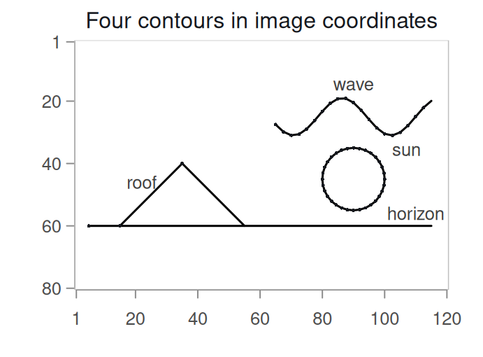
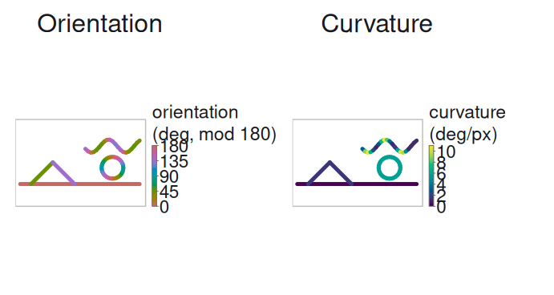

# From a line drawing to contour features

`mlvtoolbox` measures the geometry of line drawings: the orientation,
length and curvature of each contour, the junctions where contours meet,
and the medial-axis symmetry of the spaces between them. This vignette
builds a small drawing by hand, measures it, and turns the measurements
into the histograms and per-contour feature tables used as predictors in
behavioural and neuroimaging analyses. Every number quoted below is
computed when the vignette is built, and each is small enough to check
by hand.

## A drawing is a list of contours

A *contour* is one continuous stroke, stored as a matrix with one row
per straight *segment* and columns `x1`, `y1`, `x2`, `y2`. The end of
each row is the start of the next, so the rows trace the stroke in
order; the shared points are the contour’s *vertices*. A drawing
(`mlv_drawing`) is a list of contours plus the size of the canvas in
pixels.

Coordinates are image coordinates: x increases to the right, y increases
downward, and pixel centres sit at integers, starting at (1, 1).
Coordinates need not be integers, and a contour may extend past the
canvas.

The drawing below has four contours: a straight horizon, a roof whose
two slopes meet at a 90 degree apex, a sampled sine wave, and a closed
32-sided polygon approximating a circle (the sun). A closed contour is
one whose last point equals its first.

``` r

polyline <- function(x, y) {
  n <- length(x)
  cbind(x1 = x[-n], y1 = y[-n], x2 = x[-1], y2 = y[-1])
}
wave_x <- seq(65, 115, by = 2.5)
sun_t <- seq(0, 2 * pi, length.out = 33)

drawing <- mlv_drawing(
  list(horizon = polyline(c(5, 115), c(60, 60)),
       roof    = polyline(c(15, 35, 55), c(60, 40, 60)),
       wave    = polyline(wave_x, 25 + 6 * sin(wave_x / 5)),
       sun     = polyline(90 + 10 * cos(sun_t), 45 - 10 * sin(sun_t))),
  width = 120, height = 80,
  ids = c("horizon", "roof", "wave", "sun"))
drawing
#> <mlv_drawing> 4 contours, 55 segments, 120 x 80 pixels
```

``` r

op <- par(mar = c(2.5, 2.5, 1.5, 1), cex.main = 1, font.main = 1)
plot(drawing, lwd = 1.5, main = "Four contours in image coordinates")
vertices <- do.call(rbind, lapply(drawing$contours, function(z) z[, 1:2]))
points(vertices, pch = 16, cex = 0.35)
label_contours()
```



The drawing on its 120 × 80 pixel canvas. The y axis points down, as in
an image, and dots mark the vertices: the horizon has two, the roof
three and the sun 32.

``` r

par(op)
```

[`mlv_drawing()`](https://bbuchsbaum.github.io/mlvtoolboxR/reference/mlv_drawing.md)
checks the input before anything is measured. Rows of a contour must
connect, and a segment of zero length is an error unless you ask for it
to be removed with `zero_length = "drop"`. Keep strokes that a viewer
sees as separate in separate contours: contour identity determines which
crossings count as junctions and which histogram a contour’s length
enters.

## Segment measurements

[`as.data.frame()`](https://rdrr.io/r/base/as.data.frame.html) returns
one row per segment with three measurements.

- **Orientation** is the direction from the segment’s start to its end,
  in degrees counterclockwise from the rightward x axis. Because y
  points down, “counterclockwise” means as seen on the screen: a segment
  drawn up and to the right has orientation 45. Orientation is directed
  (0 to 360); histograms treat it as axial, modulo 180, because a line
  has no direction.
- **Length** is the Euclidean length in pixels.
- **Curvature** is in degrees per pixel. A polygon turns only at its
  vertices, so curvature is defined by where each vertex’s turning angle
  is placed. The default *vertex turning* estimator spreads each turn
  evenly over the vertex’s *dual cell*, which runs from the midpoint of
  the segment before the vertex to the midpoint of the segment after it,
  so every turn is counted once. A segment’s curvature is its mean
  curvature: the turning that falls on the segment divided by its
  length. The two end halves of an open contour belong to no vertex and
  carry no turning.

``` r

segments <- as.data.frame(drawing)
segments[segments$contour_id %in% c("horizon", "roof"),
         c("contour_id", "segment_index", "length", "orientation", "curvature")]
#>   contour_id segment_index    length orientation curvature
#> 1    horizon             1 110.00000           0   0.00000
#> 2       roof             1  28.28427          45   1.59099
#> 3       roof             2  28.28427         315   1.59099
```

These values can be checked by hand. The left slope of the roof runs
from (15, 60) to (35, 40): 20 pixels right and 20 pixels up the screen,
so its orientation is 45 degrees and its length is √800 = 28.28 pixels.
The right slope runs down and to the right, orientation 315. At the apex
the direction changes by 90 degrees. The apex’s dual cell is the inner
half of each slope, √800 pixels in all, so each slope receives 45
degrees of turning and a mean curvature of 45 / 28.28 = 1.59 degrees per
pixel. The roof’s length-weighted total curvature is 90 degrees, the
single turn at the apex. The sun’s 32 vertices each turn by 360 / 32 =
11.25 degrees; each side, 1.96 pixels long, receives half of the turn at
each of its ends, a curvature of 5.74 degrees per pixel. A true circle
of radius 10 has curvature 180 / (10π) = 5.73 degrees per pixel.

Within a segment the curvature is not uniform: the density is 3.18
degrees per pixel on the roof’s two inner halves and zero on its outer
halves.
[`curvature_profile()`](https://bbuchsbaum.github.io/mlvtoolboxR/reference/curvature_profile.md)
returns this piecewise density, one row per piece, and the curvature
histograms below integrate it exactly.

The published MLV estimator, `estimator = "mlv2023"`, is available for
comparison with published values. It returns one row per segment and
gives each segment the whole turn to the next segment divided by its own
length; the last segment of an open contour, which has no next segment,
repeats the turn from the one before it.

``` r

published <- as.data.frame(drawing, estimator = "mlv2023")
published_roof <- published[published$contour_id == "roof", ]
published_roof[, c("segment_index", "length", "orientation", "curvature")]
#>   segment_index   length orientation curvature
#> 2             1 28.28427          45  3.181981
#> 3             2 28.28427         315  3.181981
```

Both slopes now receive 3.18 degrees per pixel, the whole 90 degree turn
each, so the roof’s total curvature is 180 degrees, twice the actual
turn. Because a vertex’s turn is divided by the length of one
neighbouring segment only, the published values also depend on how a
curve is sampled: a circle whose vertices alternate between short and
long spacings receives two different curvatures, where the turning
estimator gives one. The section on feature specifications below
compares the estimators.

[`plot()`](https://rdrr.io/r/graphics/plot.default.html) colours
segments by a measurement and adds a colour bar that names the quantity
and its unit. Orientation uses a cyclic palette over 0 to 180 degrees,
so the roof’s two slopes (45 and 135 degrees, axially) sit on opposite
sides of the colour wheel and a horizontal segment has the same colour
whichever way it was drawn. Length and curvature use a sequential
palette.

``` r

op <- par(mfrow = c(1, 2), mar = c(0.5, 0.5, 1.5, 3), cex.main = 1, font.main = 1)
plot(drawing, property = "orientation", lwd = 2.5, axes = FALSE,
     main = "Orientation")
plot(drawing, property = "curvature", lwd = 2.5, axes = FALSE,
     main = "Curvature")
```



Orientation (left, cyclic palette) and curvature (right). Segments are
coloured by their mean curvature. The straight horizon has zero
curvature; the roof’s two slopes share the apex turn equally; the wave
is most curved at its peaks and troughs.

``` r

par(op)
```

The colour scale for length and curvature runs over the data range by
default. Pass a fixed `zlim` when several drawings must share one scale.

## Storing measurements and junctions

[`compute_contour_properties()`](https://bbuchsbaum.github.io/mlvtoolboxR/reference/compute_contour_properties.md)
measures the drawing once and stores the results on it: the segment
table, the length of each contour, and the junctions between contours.

``` r

measured <- compute_contour_properties(drawing)
measured$contour_properties
#>   contour_id    length
#> 1    horizon 110.00000
#> 2       roof  56.56854
#> 3       wave  64.69867
#> 4        sun  62.73097
measured$junctions[, c("x", "y", "type", "min_angle", "max_angle")]
#>    x  y type min_angle max_angle
#> 1 15 60    T        45       180
#> 2 55 60    T        45       180
```

The roof ends on the horizon at both eaves, so the drawing has 2
junctions, both T-junctions: the horizon contributes two arms and the
roof slope a third, at 45 degrees to the horizon. How junctions are
found, what an arm is and how the type and angles are defined are the
subject of
[`vignette("junctions", package = "mlvtoolbox")`](https://bbuchsbaum.github.io/mlvtoolboxR/articles/junctions.md).

## Histograms

Most analyses do not use segment tables directly. They use histograms
that summarize a drawing, or each contour, in a fixed set of bins.
[`contour_statistics()`](https://bbuchsbaum.github.io/mlvtoolboxR/reference/contour_statistics.md)
returns them in long form, one row per bin.

``` r

stats <- contour_statistics(measured,
                            properties = c("orientation", "length", "curvature"))
head(stats[stats$property == "orientation",
           c("property", "label", "lower", "upper", "value", "units")], 8)
#>      property label  lower  upper      value  units
#> 1 orientation     0 -11.25  11.25 122.865077 pixels
#> 2 orientation  22.5  11.25  33.75  13.434010 pixels
#> 3 orientation    45  33.75  56.25  64.497085 pixels
#> 4 orientation  67.5  56.25  78.75   7.841371 pixels
#> 5 orientation    90  78.75 101.25   7.841371 pixels
#> 6 orientation 112.5 101.25 123.75   7.841371 pixels
#> 7 orientation   135 123.75 146.25  53.706382 pixels
#> 8 orientation 157.5 146.25 168.75  15.971516 pixels
```

The weighting is part of the definition of each histogram, and the
defaults were chosen so that the histograms describe ink, not vertex
counts:

- the orientation histogram adds each segment’s length to the bin of its
  axial orientation, so a contour sampled with more vertices does not
  count more;
- the length histogram adds each whole contour’s length to the bin of
  that length;
- the curvature histogram adds length to the bin of the curvature
  density along it, so the roof’s inner halves enter one bin and its
  outer halves the zero bin.

Length and curvature bins are equally spaced in log10(1 + x) between the
ends of `length_range` (by default 2 pixels and the canvas width plus
height) and `curvature_range` (by default 0 to 90 degrees per pixel).
Here the 8 length bins have edges at 2, 4.07, 7.58, 13.5, 23.6, 40.5,
69.3, 118, 200 pixels, and the curvature bins at 0, 0.757, 2.09, 4.43,
8.54, 15.8, 28.5, 50.8, 90 degrees per pixel. Values outside a range
enter the first or last bin.

Orientation bins are centred on 0, 22.5, 45, … degrees, so the first bin
runs from −11.25 to 11.25 degrees. It holds 122.9 pixels: the 110-pixel
horizon plus the near-horizontal parts of the wave and the sun. The 45
degree bin receives the left roof slope (28.3 pixels) and about as much
again from the rising flanks of the wave (28.4 pixels), plus 7.8 from
the sun. The 135 degree bin receives the right slope, 17.6 pixels of
wave and the same 7.8 from the sun. In the length histogram the horizon
alone fills the bin from 69.3 to 117.8 pixels; the other three contours,
57 to 65 pixels long, share the bin below it.

``` r

op <- par(mfrow = c(1, 2), mar = c(4.8, 4.2, 2, 0.5), las = 1, cex.axis = 0.8,
          cex.main = 1, font.main = 1)
barplot(ori$value, names.arg = ori$label, col = "grey60", border = NA,
        cex.names = 0.75, las = 2, ylab = "segment length (px)",
        main = "Orientation")
mtext("bin centre (deg)", side = 1, line = 3.6, cex = 0.8)
barplot(len$value, names.arg = signif(len$center, 2), col = "grey60",
        border = NA, cex.names = 0.75, las = 2,
        ylab = "contour length (px)", main = "Length")
mtext("bin centre (px)", side = 1, line = 3.6, cex = 0.8)
```


Drawing-level histograms. Orientation (left) is weighted by segment
length and dominated by the horizontal bin; length (right) counts
whole-contour length in logarithmic bins.

``` r

par(op)
```

With `normalize = TRUE` each histogram is divided by total contour
length and expressed per 10,000 pixels of contour, so drawings with
different amounts of ink can be compared. With `by = "contour"` the
histograms are computed per contour instead of per drawing.

## Per-contour feature tables

[`feature_table()`](https://bbuchsbaum.github.io/mlvtoolboxR/reference/feature_table.md)
puts the per-contour histograms side by side: one row per contour, one
column per bin, normalized per 10,000 pixels by default. This is the
format used to fit a model of a per-contour response.

``` r

features <- feature_table(measured)
dim(features)
#> [1]  4 30
features[, c("contour_id", paste0("orientation_", 1:8))]
#>   contour_id orientation_1 orientation_2 orientation_3 orientation_4
#> 1    horizon    10000.0000        0.0000         0.000             0
#> 2       roof        0.0000        0.0000      5000.000             0
#> 3       wave      776.4775      864.4132      4385.166             0
#> 4        sun     1250.0000     1250.0000      1250.000          1250
#>   orientation_5 orientation_6 orientation_7 orientation_8
#> 1             0             0         0.000         0.000
#> 2             0             0      5000.000         0.000
#> 3             0             0      2717.326      1256.617
#> 4          1250          1250      1250.000      1250.000
```

The rows can again be read off the geometry. All of the horizon’s length
lies in the first orientation bin, so it scores 10,000 there and zero
elsewhere. The roof’s length divides equally between the 45 and 135
degree bins (5,000 each). The sun’s 32 equal segments step through every
orientation in 11.25 degree increments, four per bin, so each of the
eight bins holds 1,250.

The table carries a schema that records each column’s bin edges,
weights, units and normalization. `feature_schema(features)` returns it,
and model prediction uses it to refuse tables measured differently from
the training data (see
[`vignette("workflows", package = "mlvtoolbox")`](https://bbuchsbaum.github.io/mlvtoolboxR/articles/workflows.md)).

## Feature specifications

Two settings above depend on things other than the contour geometry. The
default length bins end at the canvas width plus height, so the same
contours on a larger canvas fall into different bins. The curvature
estimator, junction rule and medial-axis method also change the numbers.
A *feature specification* fixes all of these in one object, so that
every drawing in a study is measured the same way and the choices are
recorded with the results.

``` r

larger <- mlv_drawing(drawing$contours, width = 240, height = 160,
                      ids = drawing$ids)
default_small <- feature_table(drawing, properties = "length")
default_large <- feature_table(larger, properties = "length")
rbind(small_canvas = default_small[1, -1], large_canvas = default_large[1, -1])
#>              length_1 length_2 length_3 length_4 length_5 length_6 length_7
#> small_canvas        0        0        0        0        0        0    10000
#> large_canvas        0        0        0        0        0    10000        0
#>              length_8
#> small_canvas        0
#> large_canvas        0
```

``` r

spec <- feature_spec(c("orientation", "length", "curvature"),
                     length_range = c(2, 400))
identical(feature_table(drawing, spec = spec)[, -1],
          feature_table(larger, spec = spec)[, -1])
#> [1] TRUE
spec$settings[c("estimator", "bins", "length_range", "normalize")]
#> $estimator
#> [1] "turning"
#> 
#> $bins
#> [1] 8
#> 
#> $length_range
#> [1]   2 400
#> 
#> $normalize
#> [1] TRUE
```

Under the specification the horizon’s length bin no longer depends on
the canvas. The specification also records method definitions for the
curvature estimator, the junction rule and the medial-axis stages, which
is why a table built under one specification cannot silently be mixed
with one built under another.

The `estimator` setting selects the curvature definition. `"turning"`,
the default, is the vertex turning estimator described above: each
vertex turn is counted once, spread evenly over the vertex’s dual cell,
and it has no tuning parameter. `"arclength"` spreads each turn over a
tent of half-width `curvature_scale` pixels along the contour, so
curvature is expressed at a stated spatial scale and each turn is still
counted once. Its values stop depending on vertex density once segments
are shorter than that scale; a coarsely sampled contour still
concentrates its turns at its few vertices. Both wrap around closed
contours. `"mlv2023"` is the published estimator.

``` r

roof_only <- subset_contours(drawing, "roof")
profiles <- list(mlv2023 = as.data.frame(roof_only, estimator = "mlv2023"),
                 turning = curvature_profile(roof_only, "turning"),
                 arclength = curvature_profile(roof_only, "arclength", scale = 2))
sapply(profiles, function(p) sum(p$curvature * p$length))
#>   mlv2023   turning arclength 
#>       180        90        90
```

The integrated curvature of the roof, the sum of curvature times length,
is 180 degrees under the published estimator and 90 degrees under the
turning and arc-length estimators, which matches the single 90 degree
turn at the apex.
[`contour_turning()`](https://bbuchsbaum.github.io/mlvtoolboxR/reference/contour_turning.md)
lists the unsmoothed vertex turns directly.

``` r

step_profile <- function(p) {
  s0 <- if (is.null(p$s_start)) c(0, cumsum(p$length)[-nrow(p)]) else p$s_start
  s1 <- if (is.null(p$s_end)) cumsum(p$length) else p$s_end
  k0 <- if (is.null(p$curvature_start)) p$curvature else p$curvature_start
  k1 <- if (is.null(p$curvature_end)) p$curvature else p$curvature_end
  list(s = as.vector(rbind(s0, s1)), k = as.vector(rbind(k0, k1)))
}
op <- par(mfrow = c(1, 3), mar = c(4, 4, 2, 0.5), las = 1, cex.axis = 0.85,
          cex.main = 1, font.main = 1)
for (e in names(profiles)) {
  z <- step_profile(profiles[[e]])
  plot(z$s, z$k, type = "n", ylim = c(0, 50), xlab = "arc length (px)",
       ylab = "curvature (deg/px)", main = e, bty = "l")
  polygon(c(z$s, rev(z$s)), c(z$k, rep(0, length(z$k))),
          col = "grey85", border = NA)
  lines(z$s, z$k, lwd = 1.5)
  abline(v = sqrt(800), lty = 3, col = "grey40")
  text(sqrt(800), 48, "apex", pos = 4, cex = 0.8, col = "grey30")
  text(56, 20, sprintf("area %g deg", totals[[e]]), adj = 1, cex = 0.85)
}
```


Curvature along the roof under three estimators. The published estimator
spreads the apex turn over both whole slopes and counts it twice (shaded
area 180 degrees); the turning and arc-length estimators each enclose 90
degrees.

``` r

par(op)
```

The estimators also differ in how they respond to sampling. A circle of
radius 10 drawn as a regular polygon has one curvature under every
estimator, the polygon’s turn over its side, which approaches 180 /
(10π) degrees per pixel as vertices are added. If the vertices instead
alternate between a short and a long spacing (1 : 2 in angle), the
turning estimator still gives a single value, while the published
estimator divides each vertex’s turn by the length of the segment before
it and splits the circle into two curvatures:

``` r

circle <- function(n, spacing) {
  t <- c(0, cumsum(rep(spacing, length.out = n))) / sum(rep(spacing, length.out = n)) * 2 * pi
  mlv_drawing(list(polyline(60 + 10 * cos(t), 40 - 10 * sin(t))), 120, 80)
}
occupied <- function(d, e) {
  h <- contour_statistics(d, "curvature", estimator = e)
  paste(sprintf("%.2f-%.2f", h$lower, h$upper)[h$value > 0], collapse = " and ")
}
resampled <- expand.grid(vertices = c(16, 32, 64, 128), estimator = c("turning", "mlv2023"),
                         stringsAsFactors = FALSE)
resampled$regular <- mapply(function(n, e) occupied(circle(n, 1), e), resampled$vertices, resampled$estimator)
resampled$alternating <- mapply(function(n, e) occupied(circle(n, c(1, 2)), e), resampled$vertices, resampled$estimator)
resampled
#>   vertices estimator   regular              alternating
#> 1       16   turning 4.43-8.54                4.43-8.54
#> 2       32   turning 4.43-8.54                4.43-8.54
#> 3       64   turning 4.43-8.54                4.43-8.54
#> 4      128   turning 4.43-8.54                4.43-8.54
#> 5       16   mlv2023 4.43-8.54 2.09-4.43 and 8.54-15.76
#> 6       32   mlv2023 4.43-8.54 2.09-4.43 and 8.54-15.76
#> 7       64   mlv2023 4.43-8.54 2.09-4.43 and 8.54-15.76
#> 8      128   mlv2023 4.43-8.54 2.09-4.43 and 8.54-15.76
```

The table gives the range, in degrees per pixel, of each curvature bin
that receives length (8 bins from 0 to 90 degrees per pixel). For new
studies use the turning default, or the arc-length estimator with a
curvature scale chosen for the stimulus resolution when curvature should
be stated at a spatial scale; choose a scale longer than the typical
segment so that the values do not depend on how finely contours were
sampled. The published estimator is the right choice only when results
must be comparable with published MLV values
([`vignette("mlv-compatibility", package = "mlvtoolbox")`](https://bbuchsbaum.github.io/mlvtoolboxR/articles/mlv-compatibility.md)).
The same specification can express physical units:
`units = "visual_degrees"` with a `pixels_per_degree` calibration
reports lengths in degrees of visual angle (curvature stays in geometric
degrees per unit length).

## Where to go next

- [`vignette("junctions", package = "mlvtoolbox")`](https://bbuchsbaum.github.io/mlvtoolboxR/articles/junctions.md):
  how junctions are found, what an arm is, and where the default rule
  differs from MLV.
- [`vignette("medial-axis", package = "mlvtoolbox")`](https://bbuchsbaum.github.io/mlvtoolboxR/articles/medial-axis.md):
  the medial axis and the parallelism, separation, mirror and taper
  scores mapped back onto contours.
- [`vignette("mlv-compatibility", package = "mlvtoolbox")`](https://bbuchsbaum.github.io/mlvtoolboxR/articles/mlv-compatibility.md):
  reproducing published MLV values and what each default changes.
- [`vignette("workflows", package = "mlvtoolbox")`](https://bbuchsbaum.github.io/mlvtoolboxR/articles/workflows.md):
  reading SVG, MAT and image files, and fitting and applying models to
  feature tables.
- [`vignette("stimulus-design", package = "mlvtoolbox")`](https://bbuchsbaum.github.io/mlvtoolboxR/articles/stimulus-design.md):
  selecting matched subsets of contours across a stimulus set.
