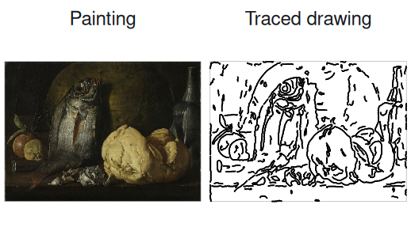
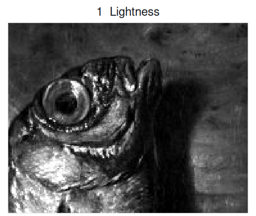
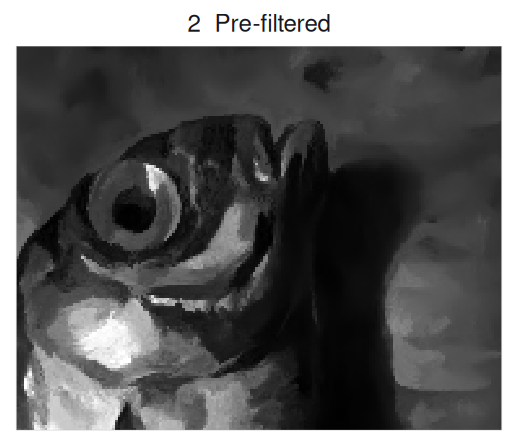
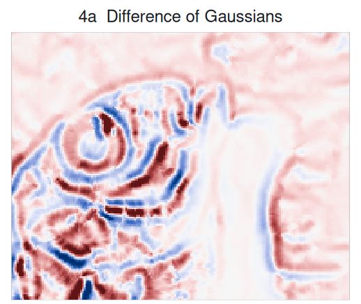
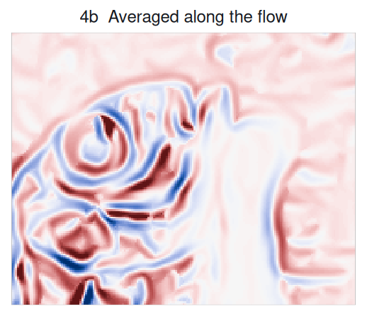
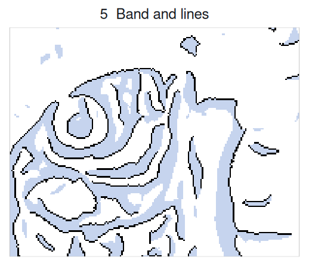
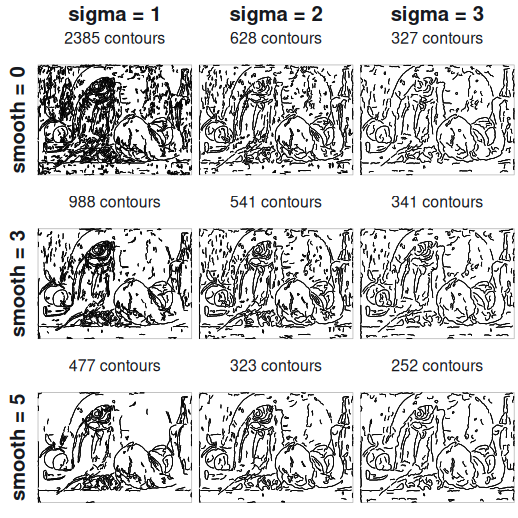
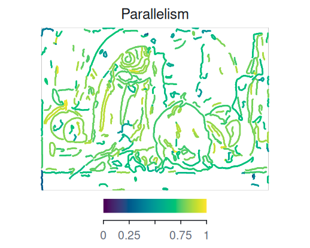
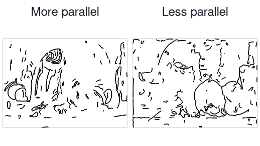

# From an image to a line drawing

To measure a photograph or a painting, you first need its line drawing.
The Mid-Level Vision (MLV) Toolbox traces photographs with learned
models (structured edges or the Segment Anything model). `mlvtoolbox`
bundles no model weights;
[`trace_rgb()`](https://bbuchsbaum.github.io/mlvtoolboxR/reference/trace_rgb.md)
takes the extractor as a `backend` function and records it with the
drawing. This vignette describes the package’s own extractor, which
needs no weights,
[`extract_lines()`](https://bbuchsbaum.github.io/mlvtoolboxR/reference/extract_lines.md),
and its backend form,
[`xdog_lines()`](https://bbuchsbaum.github.io/mlvtoolboxR/reference/xdog_lines.md):

``` r

img <- read_mlv_image("painting.jpg")
drawing <- trace_rgb(img, backend = xdog_lines)
```

The extractor aims to follow the image’s form (outlines, folds and major
shading boundaries) rather than individual brush strokes, places each
line on its edge to within about a pixel, and is deterministic. It is a
filter, not a model. Each stage is a published image operation, except a
small step of this package’s own that places lines on the edges and
draws thin strokes once. The extraction definition and parameter values
are recorded with the result.

## The running example

The example is Luis Meléndez’s *Still Life with Fish, Bread, and Kettle*
(c. 1772, oil on canvas; The Cleveland Museum of Art, accession
1983.97), a public-domain painting released under Creative Commons Zero
(CC0) through the museum’s Open Access programme. The package includes
it downsampled to 640 × 458 pixels (65 KB); `inst/extdata/README.md`
gives its source and licence. That is the width at which the defaults
were tuned.



The painting (left) and its drawing at the default settings (right): 323
contours, 13277 px of line, 65 of them shorter than 15 px. The arc of
the round copper vessel behind the fish, the fish’s head, the loaves,
the citrus fruit and the table edge are recognisable; the pewter vessel
at right, dark on a dark wall, is broken into pieces, and the wall’s
streaks and the fish’s scales leave many short marks.

``` r

painting <- system.file("extdata", "melendez-still-life.jpg", package = "mlvtoolbox")
img <- read_mlv_image(painting)
dim(img)
#> [1] 458 640   3
drawing <- trace_rgb(img, backend = xdog_lines)
drawing
#> <mlv_drawing> 323 contours, 11467 segments, 640 x 458 pixels
```

## Stage by stage

[`line_extraction_stages()`](https://bbuchsbaum.github.io/mlvtoolboxR/reference/line_extraction_stages.md)
runs the same computation as
[`extract_lines()`](https://bbuchsbaum.github.io/mlvtoolboxR/reference/extract_lines.md)
and returns every intermediate image. The figures below show them for
the fish’s head, numbered as the steps are taken, on the same canvas, so
they can be compared like the pages of a flip-book.

**Lightness.** The image is converted from sRGB to CIE L\* lightness
(white is 100), divided by 100. Lightness is close to perceived
brightness, so equal steps are about equally visible across the range.
With `colour = TRUE` the next two stages also use the colour axes a\*
and b\*; the line decision itself always uses lightness.



Stage 1. Brushwork is finer than form: the head’s scales are speckled
and the copper vessel behind it is mottled, both finer than the outlines
the drawing should keep. CIE lightness of the fish’s head, on a grey
scale stretched from L\* = 6 (black) to 61 (white), the window’s 1st and
99th percentiles.

**Pre-filter.** An anisotropic Kuwahara filter (Kyprianidis, Kang and
Döllner 2009) replaces each pixel with the mean of the most uniform part
of an elliptical neighbourhood, aligned with the local edge and split
into eight overlapping sectors. Within a region it averages away
texture; at a boundary, the uniform sectors lie on one side, so the
boundary stays sharp. `smooth` sets the radius, here 5 px.



Stage 2. The pre-filter flattens texture but not outlines: the scales
and the mottling merge into flat patches while the head, eye and gill
stay sharp. Kuwahara radius 5 px; 32% of the window’s pixels changed by
more than 2 L\* units. Grey scale as in Stage 1.

**Edge tangent flow.** The structure tensor of the smoothed image, the
local average of the gradient’s outer product at scale `sigma_c`, gives
at every pixel the direction along which lightness changes least: the
edge tangent (Kyprianidis and Döllner 2008). Its anisotropy, from 0 to
1, says how clearly one direction dominates.


Stage 3. The tangents ring the eye and run along the outlines of the
head; in the background they follow faint streaks and turn from patch to
patch. Blue segments at every fifth pixel over the faded pre-filtered
image, 1 to 5 px long as the anisotropy rises from 0 to 1 (median 0.72
here).

**Flow-based difference of Gaussians.** At every pixel a one-dimensional
difference of Gaussians, `G_sigma - tau * G_(k sigma)`, is taken across
the flow (Kang, Lee and Chui 2007). It is negative on the dark side of
an edge and positive on the light side. With `tau` just below 1, a
uniform area keeps a small positive value, so faint texture does not
cross zero.



Stage 4a. Each outline becomes a pair of bands, blue on its dark side
and red on its light side; the background’s remaining texture gives
weak, broken responses. Difference of Gaussians across the flow (sigma =
2 px, k = 1.6, tau = 0.98), blue below zero, red above, saturating at
+/- 0.038, a third of the image’s largest value (1% of this window is
clipped).

The response is then averaged along the flow, over a Gaussian of scale
`sigma_m` following each tangent streamline. Along an outline the
averaging adds up responses of the same sign and joins short gaps;
across texture it mixes signs and cancels. A streamline stops once it
has turned more than 20 degrees from where it started, so corners are
not rounded off.



Stage 4b. Averaging along the flow (sigma_m = 3 px) joins the blue bands
and thins the background speckle: the window’s separate blue patches
fall from 59 to 32. Palette as in Stage 4a. The blue, where the response
is below eps = 0, is the ink band of Stage 5.

**Threshold and placement.** The XDoG threshold (Winnemöller,
Kyprianidis and Olsen 2012) turns the response into an ink band, and the
band lies on the dark side of each edge, about 1.2 `sigma` deep. A
drawing traced from the band would sit beside the edges. The next step
is this package’s own: each line is drawn on the boundary between the
band and its light side, at the pixel nearer the edge. A thin stroke is
drawn once, along its middle: a dark band no wider than 3 `sigma` with
light on both sides, or a narrower light gap (up to about 4 px at the
default `sigma`) with dark on both sides. Groups of line pixels smaller
than `min_component` pixels are removed.



Stage 5. The lines (black, 1612 px) run along the light-side edge of the
ink band (pale blue, 7188 px), where the lightness changes, not through
its middle. Isolated band patches in the background are outlined too,
unless the outline has fewer than min_component = 20 pixels.

[`trace_contours()`](https://bbuchsbaum.github.io/mlvtoolboxR/reference/trace_contours.md),
which
[`trace_rgb()`](https://bbuchsbaum.github.io/mlvtoolboxR/reference/trace_rgb.md)
calls, then thins the mask to one pixel and traces it into contours,
splitting them where lines meet.


Stage 6. Each contour runs along the boundary it came from rather than
beside it: the outline of the head, the pupil and the curves of the gill
are each one or a few contours. Traced contours (black; 42 touch this
window) over the faded painting. The lines are pixel chains; simplify in
trace_contours() turns them into fewer, straighter segments.

## How the parameters change the drawing

Two parameters do most of the work. `sigma` sets the scale of the edges
that are drawn: small values follow fine detail, large values only broad
boundaries. `smooth` sets the radius of the pre-filter: 0 turns it off
and draws texture.



Larger sigma gives fewer lines in every row; smoothing matters most at
sigma = 1 (2385 contours unsmoothed, 477 at smooth = 5) and little at
sigma = 3. Columns: sigma = 1, 2, 3 px; rows: smooth = 0, 3, 5 px; the
default is bottom middle. The median contour grows from 7 px (top left)
to 30 px (bottom right).

The defaults (`sigma = 2`, `smooth = 5`, `tau = 0.98`, `sigma_m = 3`,
`min_component = 20`) were chosen by eye on four public-domain paintings
640 px wide, this one among them: two still lifes with crisp outlines in
dark rooms, a landscape built of thick directional strokes, and a
landscape of broad colour fields. They are a judgment, not an optimum.
`sigma`, `sigma_c`, `sigma_m` and `smooth` are in pixels, so an image
twice as large wants them about twice as large.

## Measuring the drawing

A traced drawing is an ordinary `mlv_drawing`, so every measure in the
package applies to it. Per-contour features:

``` r

features <- feature_table(drawing)
dim(features)
#> [1] 323  30
round(head(features[, c("orientation_1", "orientation_5", "length_4", "curvature_1")], 3), 3)
#>   orientation_1 orientation_5 length_4 curvature_1
#> 1      3011.203      2479.814        0     302.379
#> 2       633.787      4436.508    10000     672.232
#> 3         0.000      8146.144        0     113.026
```

The detector finds 21 junctions in the extracted drawing. FDoG can break
contours at points where they meet in the source image. [Junctions at
occlusions](#junctions-at-occlusions) shows how to enable short repairs
supported by the image.

``` r

junctions <- detect_junctions(drawing)
table(junctions$type)
#> 
#> Arrow     T     Y 
#>     5    12     4
```

The medial axis describes the space between the lines. Parallelism is
high where two lines run alongside each other at a constant distance,
such as the stripes of the fish’s body or the sides of the pewter
vessel:

``` r

mat <- analyse_mat(drawing, properties = "parallelism")
```



Each contour coloured by its mean parallelism, the mean of the scores
mapped onto its pixels (Viridis, 0 to 1; median over contours 0.75).
Lines that run beside another at a steady distance, such as the stripes
of the fish’s body, score near the top; outlines facing open space, such
as the arc of the copper vessel, score lower.

Measurements can also select contours. Here the drawing is split by mean
parallelism into two halves of at most equal total length. The split
does not follow objects; it separates lines that run beside another line
from lines that face open space.

``` r

halves <- split_contours(mat$drawing, property = "parallelism", fraction = 0.5)
c(top = length(halves$top$contours), bottom = length(halves$bottom$contours))
#>    top bottom 
#>    161    161
```



The more parallel half of the drawing (left: 161 contours, 6621 px) and
the less parallel half (right: 161 contours, 6618 px), each holding at
most half the total length. 1 contour (39 px), ranked near the middle,
would overflow either budget and belongs to neither. Compare the stripes
of the fish’s body (left) with the arc of the copper vessel (right).

## Recording the extraction

The mask carries its definition, and
[`trace_rgb()`](https://bbuchsbaum.github.io/mlvtoolboxR/reference/trace_rgb.md)
copies it into the drawing, so a drawing states how it was made:

``` r

drawing$source$provider_version
#> [1] "fdog-xdog-1"
str(drawing$source$extraction_parameters[c("sigma", "smooth", "tau")])
#> List of 3
#>  $ sigma : num 2
#>  $ smooth: num 5
#>  $ tau   : num 0.98
```

A feature specification can fix the extraction as well as the measures.
[`trace_rgb()`](https://bbuchsbaum.github.io/mlvtoolboxR/reference/trace_rgb.md)
then passes the specification’s parameters to the backend and checks
that the mask it returns was made with them; a specification naming
another version of the extractor is rejected.

``` r

spec <- feature_spec(extraction = list(lines = list(sigma = 2, smooth = 5)))
spec$definitions[["lines"]]
#> [1] "fdog-xdog-1"
same <- trace_rgb(img, backend = xdog_lines, spec = spec)
identical(same$contours, drawing$contours)
#> [1] TRUE
try(feature_spec(extraction = list(provider = "xdog_lines", provider_version = "fdog-xdog-0")))
#> Error : unsupported line extraction definition 'fdog-xdog-0'
```

## Using a learned extractor

A learned edge or contour model fits the same slot. A backend is any
function that takes the RGB array and returns a logical ink mask of the
same size; if it attaches an `"extraction"` attribute,
[`trace_rgb()`](https://bbuchsbaum.github.io/mlvtoolboxR/reference/trace_rgb.md)
records its version and parameters. The package bundles no model
weights, so the model, its weights and its preprocessing remain the
backend’s responsibility. A sketch, with a hypothetical
`predict_edges()` that returns edge probabilities:

``` r

model_lines <- function(image, threshold = 0.5) {
  probability <- predict_edges(image)          # your model, your weights
  mask <- probability > threshold
  attr(mask, "extraction") <- list(method = "my-edge-model-2024-06",
                                   parameters = list(threshold = threshold))
  mask
}
drawing <- trace_rgb(img, backend = model_lines, threshold = 0.4)
spec <- feature_spec(extraction = list(provider = "model_lines",
                                       provider_version = "my-edge-model-2024-06"))
```

The same mechanism works for any function. Here a threshold on lightness
stands in for a model: it marks the darkest twentieth of the painting as
ink, which is only useful for showing the provenance it records.

``` r

dark_lines <- function(image, fraction = 0.05) {
  lightness <- line_extraction_stages(image, smooth = 0)$lightness
  mask <- lightness < quantile(lightness, fraction)
  attr(mask, "extraction") <- list(method = "darkest-fraction-1",
                                   parameters = list(fraction = fraction))
  mask
}
toy <- trace_rgb(img, backend = dark_lines)
toy$source[c("extraction_provider", "provider_version", "extraction_parameters")]
#> $extraction_provider
#> [1] "dark_lines"
#> 
#> $provider_version
#> [1] "darkest-fraction-1"
#> 
#> $extraction_parameters
#> $extraction_parameters$fraction
#> [1] 0.05
```

## Limits

- Lines are decided on lightness. A boundary between two colours of
  equal lightness is not drawn, with or without `colour = TRUE`, which
  only lets colour steer the flow and the pre-filter.
- The pre-filter rounds sharp corners slightly: at the default radius a
  square’s traced corner lies up to about 1.2 px inside the true corner.
- It also removes dark strokes narrower than about 2 px unless they lie
  along a pixel row or column; light strokes survive from 1 px.
  `smooth = 0` keeps them, so use it for thin line art.
- Parallel dark strokes 2 to 4 px apart (hatching) merge and are drawn
  as the pair’s two outer outlines, with no line between them.
- Lines are placed to the nearest pixel. On synthetic edges the traced
  contours lie within 1 px of the true boundary (about 0.5 px on
  straight edges away from the image border), and a traced disc has the
  right length to within 2% after `simplify = 1`.
- All scales are in pixels. The defaults were tuned on four paintings
  640 px wide; images of other sizes want `sigma`, `sigma_c`, `sigma_m`
  and `smooth` scaled with them.

### Junctions at occlusions

Three regions in this synthetic image meet at a single T junction. The
thresholded FDoG band loses part of the vertical branch. With the
default settings, the simplified branch stops 5 pixels short of the
horizontal contour. A positive `junction_gap` lets the extractor bridge
a short gap when the edge contrast continues in the source image.

``` r

occlusion <- matrix(0.80, 256L, 256L)
occlusion[1:128, 129:256] <- 0.50
occlusion[129:256, ] <- 0.15
occlusion_stages <- line_extraction_stages(occlusion)
occlusion_drawing <- trace_contours(occlusion_stages$mask, simplify = 1)
repaired_mask <- extract_lines(occlusion, junction_gap = 6)
repaired_drawing <- trace_contours(repaired_mask)
c(default = nrow(detect_junctions(occlusion_drawing)),
  repaired = nrow(detect_junctions(repaired_drawing)))
#>  default repaired 
#>        0        1
```

The repair gives the default detector one T. For an RGB image, enable
the same option with
`trace_rgb(img, backend = xdog_lines, junction_gap = 6)`. The drawing
records the distinct extraction definition and gap limit.

Widening the detector’s tolerance can also recover this T after
simplification, but it can join strokes that genuinely stop short. The
repair checks the contrast across the projected branch in the original
image and skips bridges that would also touch a third piece of ink. It
can still miss short or weak branches. Check junction counts against
annotated examples at the resolution and contrast of your images. See
[issue \#2](https://github.com/bbuchsbaum/mlvtoolboxR/issues/2).

For line art whose junctions are defined by stroke centre lines, pass a
verified centre-line mask directly to
[`trace_contours()`](https://bbuchsbaum.github.io/mlvtoolboxR/reference/trace_contours.md).
A filled 5-by-5 grid in the synthetic test yields 17 closed outlines and
zero X junctions through FDoG. Its one-pixel centre-line mask yields 25
X junctions.

## References

Kang, H., Lee, S. and Chui, C. K. (2007). Coherent line drawing.
*Proceedings of the 5th International Symposium on Non-Photorealistic
Animation and Rendering*, 43–50.

Kyprianidis, J. E. and Döllner, J. (2008). Image abstraction by
structure adaptive filtering. *Proceedings of EG UK Theory and Practice
of Computer Graphics*, 51–58.

Kyprianidis, J. E., Kang, H. and Döllner, J. (2009). Image and video
abstraction by anisotropic Kuwahara filtering. *Computer Graphics
Forum*, 28(7), 1955–1963.

Kyprianidis, J. E. (2010). Anisotropic Kuwahara filtering with
polynomial weighting functions. *Proceedings of EG UK Theory and
Practice of Computer Graphics*, 25–30.

Winnemöller, H., Kyprianidis, J. E. and Olsen, S. C. (2012). XDoG: an
eXtended difference-of-Gaussians compendium including advanced image
stylization. *Computers & Graphics*, 36(6), 740–753.
