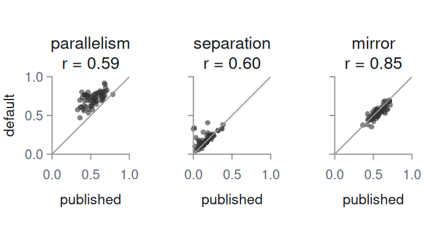

# Reproducing published MLV values

`mlvtoolbox` is an R port and extension of the Mid-Level Vision (MLV)
toolbox, the MATLAB code of the Bernhardt-Walther lab described by
Walther et al. (2023), qualified against outputs the lab computed in
MATLAB. For several measures the package defaults use alternative
definitions, chosen, for example, so that junctions and branch scores do
not depend on contour direction or on the start vertex of a closed
contour, and so that each curvature turn is counted once. Some of those
definitions change the numbers, which matters when you want to compare
new data with published MLV values or rerun a published analysis. For
that case the package keeps a *published-compatible mode*: explicit
`mlv2023` options that reproduce the MATLAB results, including the
behaviours in which the defaults differ (the two exceptions, which
differ in both modes, are listed below).

This vignette gives the exact recipe for each mode, lists what each
default changes and why, shows on small synthetic drawings where the two
modes differ and where they agree, shows how feature specifications keep
the two apart, and summarizes the qualification evidence. It ends with a
short guide to choosing a mode and describing it in a methods section.

## The two modes

The *package defaults* need no arguments. The *published-compatible
mode* sets six options: the contour curvature estimator, the junction
rule and four medial-axis settings.

``` r

# Contour curvature: also as.data.frame(), compute_contour_properties(),
# feature_table() and average_property()
contour_statistics(drawing, estimator = "mlv2023")

# Junctions
detect_junctions(drawing, rule = "mlv2023")      # implies gap_metric = "chebyshev"

# Medial axis
compute_mat(drawing, aof = "mlv2023", morphology = "hmt8", branch_rule = "mlv2023",
            threshold_angle = asin(0.3 * pi / 2) * 180 / pi)  # 28.11°, flux threshold 0.3 (MLV-M004)
```

[`analyse_mat()`](https://bbuchsbaum.github.io/mlvtoolboxR/reference/analyse_mat.md)
passes the medial-axis options through to
[`compute_mat()`](https://bbuchsbaum.github.io/mlvtoolboxR/reference/compute_mat.md),
and
[`compute_mat_properties()`](https://bbuchsbaum.github.io/mlvtoolboxR/reference/compute_mat_properties.md)
and
[`map_mat_properties()`](https://bbuchsbaum.github.io/mlvtoolboxR/reference/map_mat_properties.md)
follow the `branch_rule` recorded in the `mlv_mat`. The threshold angle
is explained below. Contour orientation and length need no option; they
are the same in both modes. Curvature does: the default counts each
vertex turn once (`estimator = "turning"`), and `estimator = "mlv2023"`
reproduces the published values.

A feature specification declares the same choices once, so that every
function that measures a drawing uses them:

``` r

angle_03 <- asin(0.3 * pi / 2) * 180 / pi   # 28.11°, flux threshold 0.3
props <- c("orientation", "length", "curvature", "junction_type",
           "parallelism", "separation", "mirror")
default <- feature_spec(props, bins = 4)
published <- feature_spec(props, bins = 4, estimator = "mlv2023",
  junction = list(rule = "mlv2023"),
  mat = list(aof = "mlv2023", morphology = "hmt8", branch_rule = "mlv2023",
             threshold_angle = angle_03))
knitr::kable(data.frame(default = default$definitions,
                        published = published$definitions))
```

|  | default | published |
|:---|:---|:---|
| contour | vertex-dual-1 | mlv2023-port-0.1.1 |
| branch | mlv2023-port-0.1.1 | mlv2023-port-0.1.1 |
| histogram | 1 | 1 |
| aof | centered-tie-mean-1 | mlv2023-computeAOF-lowest-index |
| morphology | hmt8-then-sequential-simple-pixel-removal-1 | sequential_hmt8_matlab_skel_order-1 |
| branch_rule | direction-symmetric-tiemax-graph-defined-3 | mlv2023-edgelink-lastwriter-1 |
| junction | exit-neighbourhood-1-euclidean | mlv2023-port-f12418a |
| tracing | pixel_graph_no_corner_cut | kovesi_edgelink_cleanedgelist |

Every specification records a versioned *definition* for each method.
The table shows that the two modes differ in six of them (contour
curvature, AOF, morphology, branch rule, junction rule and branch
tracing) and share the branch-score and histogram definitions.

### Why the recipe sets the threshold angle

The stored MLV datasets were computed by `computeAllMATfromVecLD.m`,
which calls `computeMAT.m` without a threshold, so MATLAB used its
fallback flux threshold of 0.3. The package derives the threshold from
an object angle, (2/π) sin(`threshold_angle`), and its default angle of
28° gives 0.298875, not 0.3 (MLV-M004). The qualification runs that
reproduced the stored values therefore passed the angle whose threshold
is exactly 0.3:

``` r

angle_03
#> [1] 28.11475
published$settings$mat$threshold_angle == angle_03
#> [1] TRUE
m <- compute_mat(mlv_drawing(list(matrix(c(5, 10, 45, 10), 1),
                                  matrix(c(5, 22, 45, 22), 1)), 50, 32),
                 spec = published)
m$parameters$threshold
#> [1] 0.3
```

With the default angle, pixels whose flux lies between the two
thresholds (17.93 and 18 of a possible 60 at 60 samples) enter the
skeleton although MATLAB excluded them. How often that happens on
natural drawings has not been measured; use the full recipe when you
need the stored values.

## What each default changes

Each default below departs from a behaviour of the pinned MATLAB source
(commit `f12418a`), and each departure is demonstrated by a synthetic
reproducer with an independently derived answer. The identifiers refer
to the [register of differences from the reference
implementations](https://github.com/bbuchsbaum/mlvtoolboxR/blob/main/DIFFERENCES.md),
which gives the reproducer and the number of affected items in the
stored datasets for each.

| Stage | MLV behaviour, reproduced by `mlv2023` | Package default | ID |
|----|----|----|----|
| Contour curvature | Each segment receives the whole turn to the next segment divided by its own length; the last segment repeats the previous turn, so one vertex per contour is counted twice (on a closed contour the closing vertex is not counted), and values depend on how the curve is sampled | Each vertex turn spread once over its dual cell, from the midpoint of the segment before it to the midpoint of the segment after it (`estimator = "turning"`) | M032 |
| Junction merging and angles | Merging depends on the order of the intersections; interior arms use a different y convention from endpoint arms; intersections at negative coordinates are discarded | Transitive merging; one angle convention; any coordinates | M006–M008 |
| Junction gap | A 1 px gap allowance measured along the larger coordinate change, so up to 1.41 px on a diagonal | Euclidean gap (`gap_metric = "euclidean"`), the same in every direction | M018 |
| Junction position | Intersections within 1e-4 of a segment end snap to the endpoint | Exact intersection | M019 |
| Junction arms | Arms of interior segments measured from the merged junction centroid | Direction of the segment through which the contour leaves | M021 |
| Junction arms | A segment attaches by its start if that lies within 2 px, so reversing a contour can change the junction | Arms are the exits of each contour from the junction neighbourhood, independent of direction | M022 |
| Junction arms | Splitting one stroke into two contours with a short middle piece creates a junction | Contours ending inside the neighbourhood contribute no arm | M023 |
| Junction arms | Every segment of a contour inside the neighbourhood counts as an arm; a slight overshoot reads as X | One arm per exit | M024, M025 |
| Junction arms | Closed contours end at their first vertex | Closed contours wrap around | M026 |
| Flux | Sampling circle centred on the pixel corner, labels read from the containing cell: ridges offset by half a pixel | Circle centred on the pixel, mean over equidistant boundary pixels (`aof = "centered"`) | M027 |
| Thinning | MATLAB `bwmorph("skel", Inf)`, reproduced by `morphology = "hmt8"`; can leave removable pixels and 2 x 2 blocks | `morphology = "minimal"`: no removable pixel remains | design choice |
| Branch scores | Forward differences: scores depend on the direction in which a branch was traced | Mean over both directions (`branch_rule = "invariant"`) | M028 |
| Mapping | Scores read from a last-writer-wins image; exact nearest-point ties resolved by enumeration order | Each branch keeps its own scores; ties take the maximum | M029 |
| Tracing | Junction points duplicated when edges are merged | No point repeated within a branch | M030 |
| Mirror score | The line fit assigns the last one or two points to the final span even when that exceeds the 1 px distance tolerance | The fit ends the span before the point that would exceed the tolerance | M016 |
| Branch scores | Undefined points (branch end points for parallelism and taper, branches of fewer than three points, mirror on three or fewer) scored 0, and that 0 averaged into neighbouring points | Undefined points NA; smoothing averages defined values only | M033 |
| Mapping | Every mapped score of exactly zero treated as missing | Valid zeros kept; missing is NA | M011 |

The thinning row records a choice of this package rather than a
difference in MLV’s behaviour: `"hmt8"` is the thinning that reproduces
MATLAB’s skeleton, and the default removes the pixels it leaves that are
not needed to keep the skeleton connected.

Two behaviours differ from MLV in both modes, because reproducing them
would produce out-of-range or undefined values rather than different
ones: separation is NA below a radius of 1 pixel instead of exceeding 1
or becoming infinite (M031), and zero-length segments are rejected or
dropped instead of producing undefined angles and curvatures (M015,
M020).

## Where the modes agree and where they differ

The drawing below has a long bar, a stem that meets it from below and a
separate short line.

``` r

seg <- function(...) matrix(c(...), nrow = 1)
drawing <- mlv_drawing(list(
  seg(10, 20, 70, 20),
  rbind(c(40, 44, 40, 21.5), c(40, 21.5, 40, 20)),
  seg(10, 32, 30, 32)), width = 80, height = 50)
```

### Orientation and length are identical; curvature is counted once

Orientation and length do not depend on the mode:

``` r

table_default <- feature_table(analyse_mat(drawing, spec = default)$drawing)
table_published <- feature_table(analyse_mat(drawing, spec = published)$drawing)
geometry <- grep("^(orientation|length)_", names(table_default), value = TRUE)
identical(table_default[geometry], table_published[geometry])
#> [1] TRUE
```

The contours of this drawing are straight, so their curvature is zero in
both modes. On a contour that turns, the published estimator counts the
turn at the last vertex twice. An open contour that turns by 90 degrees
at each of its two corners turns by 180 degrees in all:

``` r

hook <- mlv_drawing(list(rbind(c(10, 40, 30, 40), c(30, 40, 30, 20), c(30, 20, 50, 20))),
                    width = 60, height = 50)
integrated <- function(spec) with(as.data.frame(hook, spec = spec), sum(curvature * length))
c(default = integrated(default), published = integrated(published))
#>   default published 
#>       180       270
```

### Junctions

Junctions differ wherever one of MLV’s arm rules applies, for example
when a short segment at the end of a stem makes a T read as an X
(MLV-M024).
[`vignette("junctions", package = "mlvtoolbox")`](https://bbuchsbaum.github.io/mlvtoolboxR/articles/junctions.md)
shows each case on a small drawing.

### Medial-axis scores differ by design

The medial-axis defaults change values at many pixels, because they move
the ridge (M027), average the two traversal directions (M028) and change
how scores reach the contour (M029, M030). Per-contour means remain
correlated across modes. The comparison below uses eight random
synthetic drawings of eight polylines each.

``` r

set.seed(2023)
random_drawing <- function(n = 8, size = 100) {
  contours <- lapply(seq_len(n), function(i) {
    k <- sample(2:4, 1)
    p <- matrix(runif(2 * k, 8, size - 8), ncol = 2)
    cbind(p[-k, , drop = FALSE], p[-1, , drop = FALSE])
  })
  mlv_drawing(contours, size, size)
}
P <- c("parallelism", "separation", "mirror")
contour_means <- function(d, ...) {
  x <- analyse_mat(d, properties = P, ...)$drawing
  sapply(P, function(p) vapply(x$mat_properties[[p]], mean, double(1), na.rm = TRUE))
}
drawings <- replicate(8, random_drawing(), simplify = FALSE)
a <- do.call(rbind, lapply(drawings, contour_means))
b <- do.call(rbind, lapply(drawings, contour_means, aof = "mlv2023",
                           morphology = "hmt8", branch_rule = "mlv2023",
                           threshold_angle = angle_03))
ok <- stats::complete.cases(a, b)
c(contours = nrow(a), compared = sum(ok))
#> contours compared 
#>       64       64
r <- sapply(P, function(p) cor(a[ok, p], b[ok, p]))
round(r, 3)
#> parallelism  separation      mirror 
#>       0.587       0.603       0.848
```

``` r

agree <- sapply(P, function(p) mean(abs(a[ok, p] - b[ok, p]) <= 0.01))
above <- mean(a[ok, "parallelism"] > b[ok, "parallelism"])
round(100 * c(agree, parallelism_above = above))   # percent of contours
#>       parallelism        separation            mirror parallelism_above 
#>                 0                33                16                98
```

``` r

op <- par(mfrow = c(1, 3), mar = c(2.8, 2.6, 2.4, 0.6), mgp = c(1.7, 0.45, 0),
          pty = "s", las = 1, cex.axis = 0.8, cex.lab = 0.85, cex.main = 1,
          font.main = 1, tcl = -0.25)
par(cex = 0.85)                # mfrow would otherwise shrink all text by a third
for (p in P) {
  plot(b[ok, p], a[ok, p], xlim = c(0, 1), ylim = c(0, 1), xaxs = "i", yaxs = "i",
       pch = 16, cex = 0.7, col = adjustcolor("grey20", 0.6), bty = "n",
       xlab = "published", ylab = if (p == P[1]) "default" else "",
       main = sprintf("%s\nr = %.2f", p, r[[p]]), xpd = NA, axes = FALSE)
  axis(1, at = c(0, 0.5, 1), col = "grey60"); axis(2, at = c(0, 0.5, 1), col = "grey60",
                                                   labels = p == P[1])
  abline(0, 1, col = "grey60")
}
```



Per-contour mean scores for 64 contours of eight random synthetic
drawings: published (mlv2023) mode on x, package default on y, identity
line in grey, correlation in each title. The modes correlate but do not
match: even separation, the closest, agrees within 0.01 for only 33% of
contours, and default parallelism is higher for 98%.

``` r

par(op)
```

The modes agree on at most a third of contours: parallelism never agrees
within 0.01, separation does for 33% of contours and mirror for 16%. For
these random drawings the per-contour correlations between modes are
0.59 (parallelism), 0.60 (separation) and 0.85 (mirror). Random line
segments make many short, irregular branches, so these values say
nothing about natural drawings; the qualification figures for natural
drawings are in the evidence section below. Default parallelism lies
above the published values because the published estimator scores every
branch end 0 and averages that 0 into the neighbouring point (MLV-M033);
short branches are mostly ends.

### Valid zeros

The default mode keeps scores that are exactly zero; the published mode,
like `MATpropertiesToContours.m`, turns every zero into a missing value
(MLV-M011). Two lines three pixels apart have a separation of exactly 0
along their whole length
([`vignette("medial-axis", package = "mlvtoolbox")`](https://bbuchsbaum.github.io/mlvtoolboxR/articles/medial-axis.md)
explains why), so the same pixels are zeros in one mode and missing in
the other:

``` r

close_pair <- mlv_drawing(list(seg(10, 20, 50, 20), seg(10, 23, 50, 23)), 60, 40)
separation <- function(...) {
  x <- analyse_mat(close_pair, ...)$drawing
  v <- unlist(x$mat_properties$separation)
  c(zero = sum(v == 0, na.rm = TRUE), missing = sum(is.na(v)))
}
rbind(default = separation(),
      published = separation(aof = "mlv2023", morphology = "hmt8",
                             branch_rule = "mlv2023", threshold_angle = angle_03))
#>           zero missing
#> default     82       0
#> published    0      82
```

## Specifications keep the modes apart

A feature specification travels with the measurements it produced.
Functions that accept one check that the inputs they receive were
computed under the same definitions and stop otherwise, so values from
the two modes cannot be combined by accident. A medial axis computed in
published mode cannot be scored under the default specification:

``` r

published_mat <- compute_mat(drawing, spec = published)
compute_mat_properties(published_mat, spec = default)
#> ⁢Error:
#> ⁢! MAT raster specification mismatch; recompute compute_mat()
```

Scores computed under one specification cannot be mapped under the
other:

``` r

scored <- compute_mat_properties(compute_mat(drawing, spec = published), spec = published)
map_mat_properties(drawing, scored, spec = default)
#> ⁢Error:
#> ⁢! MAT score specification mismatch; recompute compute_mat_properties()
```

A specification is also checked against the definitions that the
installed version produces for its settings. Specifications saved by
mlvtoolbox 0.2.x recorded the thinning then in use, the Octave Pratt
lookup tables, and had no AOF or branch-rule definitions; such a
specification is rejected rather than silently reinterpreted. The
example below changes one recorded definition to the 0.2.x value:

``` r

old <- default
old$definitions[["morphology"]] <- "octave_image_pratt_2.20.0"
validate_feature_spec(old)
#> ⁢Error:
#> ⁢! noncanonical or unsupported feature specification definitions
```

Rebuild such a specification with
[`feature_spec()`](https://bbuchsbaum.github.io/mlvtoolboxR/reference/feature_spec.md)
and recompute the cached medial axes from the drawings.

## Qualification evidence

The numbers in this section are results of the qualification run
recorded in
[`docs/PARITY.md`](https://github.com/bbuchsbaum/mlvtoolboxR/blob/main/docs/PARITY.md)
and the reports it links. They are not recomputed here, because the
reference data are the lab’s natural drawings, which are not distributed
with the package.

The reference set holds outputs computed in MATLAB for 3,017 line
drawings (IAPS, OASIS, architectural scenes, Toronto scenes and
Snodgrass-Vanderwart drawings), 2,757 of them with per-pixel
parallelism, separation and mirror scores, plus the complete distance
map, flux and skeleton of one drawing (Forest_DBW). Rerunning the pinned
MATLAB source (f12418a) under GNU Octave reproduced every stored
geometry value and all junctions checked, so the stored outputs
correspond to that source revision.

| Stage | Published-compatible mode vs stored MATLAB | Package defaults vs stored MATLAB |
|----|----|----|
| Segment orientation, length, curvature | All 2,284,239 segments within 1e-9 | Orientation and length the same; curvature differs by design (each turn counted once, M032) |
| Junctions | 395,125 of 395,134 identical in position, type, members and angles; the other 9 depend on zero-length segments | 356,113 (90.1%) identical; every difference attributed to a recorded MLV difference or a package definition |
| Distance map, flux, skeleton (Forest_DBW) | Distances identical, flux within 2.1e-14, skeleton identical (24,904 px) | Different by design (M027, thinning) |
| Per-pixel scores (2,757 drawings) | 99.1%, 99.4% and 99.3% of pixels within 1e-4 (parallelism, separation, mirror); per-contour r = 0.9993, 0.9999, 0.9986 | Per-contour r = 0.811, 0.982, 0.864 |

The remaining per-pixel differences in published mode come from MLV’s
single-precision arithmetic, which occasionally flips an exact tie
between nearest tangent points. The qualification has stated limits:
MATLAB itself was not run, so the stored outputs serve as the reference;
MATLAB’s undocumented skeletonization was identified empirically and
matched exactly on the Forest_DBW drawing; rasterization tie rules were
observed only for integer endpoints; and extracting drawings from
photographs is not qualified.

## Choosing a mode

Use the **package defaults** for new studies. Their junctions and
medial-axis scores do not depend on contour direction, contour
numbering, the start vertex of a closed contour or the direction in
which a branch was traced, and rotating or reflecting the ink raster by
a multiple of 90° rotates or reflects the flux field in the same way.
Their curvature counts every vertex turn once and does not change when a
curve is resampled; when curvature should be stated at a physical scale,
use `feature_spec(estimator = "arclength", curvature_scale = ...)` (see
[`vignette("getting-started", package = "mlvtoolbox")`](https://bbuchsbaum.github.io/mlvtoolboxR/articles/getting-started.md)).

Use the **published-compatible mode** when values must be comparable
with numbers computed by the MATLAB toolbox: extending or replicating a
published dataset, comparing against published norms, or rerunning an
analysis whose features were computed in MATLAB. Do not mix modes within
one analysis; save the feature specification with the data, and the
checks above enforce this.

If a result depends on the mode, report both. Contour orientation and
length are identical in the two modes, curvature differs wherever a
contour turns, most junctions are identical, and per-contour medial-axis
means are highly correlated but not equal, so an effect that appears in
only one mode deserves a closer look at the drawings that drive it.

### Describing the mode in a methods section

Report the package version, the mode and the settings that differ from
the defaults, and cite both the package and the original methods.
[`citation()`](https://rdrr.io/r/utils/citation.html) gives the
references:

``` r
print(citation("mlvtoolbox"), style = "text")
Buchsbaum B (2026). _mlvtoolbox: R Implementation and Extensions of the
Mid-Level Vision Toolbox_. R package version 0.3.0 (independent R port;
original methods credited separately).

Walther D, Farzanfar D, Han S, Rezanejad M (2023). "The mid-level
vision toolbox for computing structural properties of real-world
images." _Frontiers in Computer Science_, *5*, 1140723.
doi:10.3389/fcomp.2023.1140723
<https://doi.org/10.3389/fcomp.2023.1140723>.

Rezanejad M, Downs G, Wilder J, Walther D, Jepson A, Dickinson S,
Siddiqi K (2019). "Scene Categorization from Contours: Medial Axis
Based Salience Measures." In _Proceedings of the IEEE/CVF Conference on
Computer Vision and Pattern Recognition_.
<https://openaccess.thecvf.com/content_CVPR_2019/papers/Rezanejad_Scene_Categorization_From_Contours_Medial_Axis_Based_Salience_Measures_CVPR_2019_paper.pdf>.
```

Example sentence for the package defaults:

> Contour orientation, length, curvature, junctions and medial-axis
> parallelism, separation and mirror symmetry were computed with
> mlvtoolbox 0.3.0 (Buchsbaum, 2026), an R implementation of the
> Mid-Level Vision Toolbox (Walther et al., 2023), using its default
> definitions, which differ from the MATLAB implementation in documented
> ways so that junctions and medial-axis scores do not depend on contour
> direction or numbering and each vertex turn is counted once in
> curvature; medial-axis scores follow Rezanejad et al. (2019).

Example sentence for the published-compatible mode:

> Features were computed with mlvtoolbox 0.3.0 (Buchsbaum, 2026) in its
> published-compatible mode (curvature estimator `mlv2023`; junction
> rule `mlv2023`; medial axis with `aof = "mlv2023"`,
> `morphology = "hmt8"`, `branch_rule = "mlv2023"` and an object-angle
> threshold of 28.11°, that is, a flux threshold of 0.3), which
> reproduces the values of the MATLAB Mid-Level Vision Toolbox (Walther
> et al., 2023; source revision f12418a).

If you used a nondefault threshold, window or mapping radius, state it,
and deposit the feature specification (for example as the sidecar
written by
[`write_feature_csv()`](https://bbuchsbaum.github.io/mlvtoolboxR/reference/write_feature_csv.md))
with the data.

## Where to go next

- [`vignette("medial-axis", package = "mlvtoolbox")`](https://bbuchsbaum.github.io/mlvtoolboxR/articles/medial-axis.md):
  what each medial-axis stage and score measures, on small drawings.
- [`vignette("junctions", package = "mlvtoolbox")`](https://bbuchsbaum.github.io/mlvtoolboxR/articles/junctions.md):
  the junction rules of both modes, case by case.
- [`docs/PARITY.md`](https://github.com/bbuchsbaum/mlvtoolboxR/blob/main/docs/PARITY.md)
  and the [differences
  register](https://github.com/bbuchsbaum/mlvtoolboxR/blob/main/DIFFERENCES.md):
  the qualification evidence and every recorded difference.

## References

Rezanejad, M., Downs, G., Wilder, J., Walther, D. B., Jepson, A.,
Dickinson, S., & Siddiqi, K. (2019). Scene categorization from contours:
Medial axis based salience measures. *Proceedings of the IEEE/CVF
Conference on Computer Vision and Pattern Recognition*.

Walther, D. B., Farzanfar, D., Han, S., & Rezanejad, M. (2023). The
mid-level vision toolbox for computing structural properties of
real-world images. *Frontiers in Computer Science, 5*, 1140723.
<https://doi.org/10.3389/fcomp.2023.1140723>
