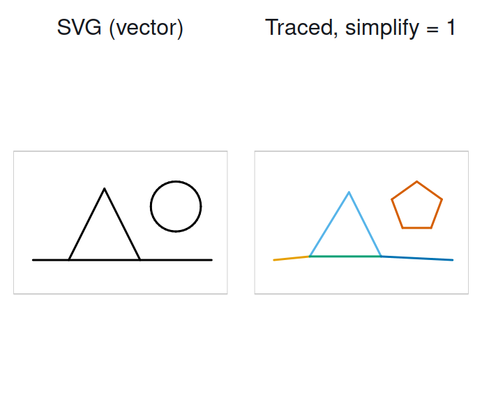
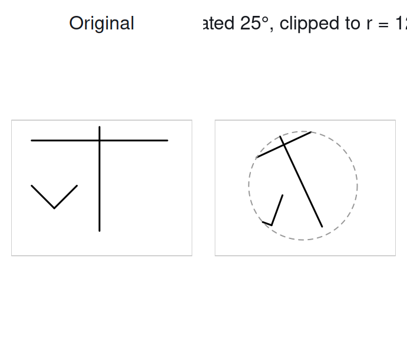

# File input, extraction and feature recipes

This vignette covers the steps around measurement: getting drawings into
R from SVG, MATLAB and image files, editing them, fixing a measurement
recipe for a study, and applying a fitted model to new drawings with a
check that the features were measured the same way. It assumes the
drawing, segment and histogram vocabulary of
[`vignette("getting-started", package = "mlvtoolbox")`](https://bbuchsbaum.github.io/mlvtoolboxR/articles/getting-started.md).

The file adapters use optional packages: xml2 for SVG, R.matlab for MAT
files, and png or jpeg for images. Chunks that need a missing package
are skipped when this vignette is built.

## Vector drawings from SVG

[`read_mlv_svg()`](https://bbuchsbaum.github.io/mlvtoolboxR/reference/read_mlv_svg.md)
reads lines, polylines, polygons, rectangles, circles, ellipses, Bézier
paths and elliptical arcs, applying any transforms. Curves are sampled
into straight segments about `curve_step` pixels long; `curve_step` sets
the sampling density and is not a guaranteed bound on the distance from
the true curve. Each SVG element becomes one contour. The viewBox origin
maps to image coordinate (1, 1). Text, embedded images, clipping, masks
and paint effects are not rendered, and with the default `strict = TRUE`
a visible unsupported element is an error rather than being silently
dropped.

``` r

svg_file <- tempfile(fileext = ".svg")
writeLines(c(
  '<svg xmlns="http://www.w3.org/2000/svg" width="60" height="40" viewBox="0 0 60 40">',
  '  <line x1="5" y1="30" x2="55" y2="30" stroke="black"/>',
  '  <polyline points="15,30 25,10 35,30" fill="none" stroke="black"/>',
  '  <circle cx="45" cy="15" r="7" fill="none" stroke="black"/>',
  '</svg>'), svg_file)
from_svg <- read_mlv_svg(svg_file)
from_svg
#> <mlv_drawing> 3 contours, 47 segments, 60 x 40 pixels
from_svg$source$method
#> [1] "svg"
```

The drawing keeps its import provenance in `$source`. The circle has
become a closed polygon whose segment count follows from `curve_step`.

## Drawings from MATLAB files

The original MLV toolbox stores vector drawings as `vecLD` structures in
MATLAB files.
[`read_mlv_mat()`](https://bbuchsbaum.github.io/mlvtoolboxR/reference/read_mlv_mat.md)
reads version 5 MAT files (not v7.3/HDF5) and returns one drawing per
structure element. Only the `contours` and `imsize` fields are read;
measurements MLV stored in the structure are ignored and recomputed.

``` r

drawings <- read_mlv_mat("drawings.mat", variable = "vecLD")
# MLV files occasionally contain zero-length segments; drop them explicitly.
drawings <- read_mlv_mat("drawings.mat", zero_length = "drop")
```

To reproduce values that MLV published for such files, see
[`vignette("mlv-compatibility", package = "mlvtoolbox")`](https://bbuchsbaum.github.io/mlvtoolboxR/articles/mlv-compatibility.md).

## Tracing raster line drawings

[`trace_contours()`](https://bbuchsbaum.github.io/mlvtoolboxR/reference/trace_contours.md)
turns a black-on-white line image, a grayscale matrix or a logical ink
mask into contours. Pixels darker than `threshold` are ink; the mask is
thinned to one pixel wide with the same thinning used for the medial
axis, and the thin ink is traced as a graph of eight-connected pixels.
Paths are split at junction pixels and closed loops stay closed.
`simplify` fits straight segments to each traced path, with a mean
point-to-line distance of at most the given number of pixels.

Here the SVG drawing is rasterized to a PNG and traced back.

``` r

png_file <- tempfile(fileext = ".png")
write_mlv_png(from_svg, png_file)
traced <- trace_contours(png_file)
traced
#> <mlv_drawing> 5 contours, 128 segments, 60 x 40 pixels
simplified <- trace_contours(png_file, simplify = 1)
simplified
#> <mlv_drawing> 5 contours, 10 segments, 60 x 40 pixels
```

``` r

op <- par(mfrow = c(1, 2), mar = c(0.5, 0.5, 2, 0.5), cex.main = 1, font.main = 1)
plot(from_svg, axes = FALSE, lwd = 1.5, main = "SVG (vector)")
plot(simplified, axes = FALSE, lwd = 1.5,
     col = rep(grDevices::palette.colors(8, "Okabe-Ito")[c(2, 3, 4, 6, 7, 8)],
               length.out = length(simplified$contours))[
       as.data.frame(simplified)$contour_index],
     main = "Traced, simplify = 1")
```



The SVG drawing (left) and its traced raster copy simplified to 1 px
(right). Colours mark traced contours: tracing splits the horizon where
the roof meets it, thinning bends the traced horizon slightly near those
junctions, and the coarse simplification reduces the circle to a
pentagon.

``` r

par(op)
```

Traced drawings differ from vector drawings in ways that change
measurements. A raster has no record of which stroke a pixel came from,
so tracing splits contours at every junction: the horizon, one contour
in the SVG, becomes several. Contour identity affects junction
detection, length histograms and every per-contour feature, so
measurements of a traced drawing are not interchangeable with
measurements of its vector source.

For colour photographs,
[`trace_rgb()`](https://bbuchsbaum.github.io/mlvtoolboxR/reference/trace_rgb.md)
takes an RGB image and a `backend` function that returns a logical ink
mask. The package does not bundle an edge or segmentation model;
whatever produces the mask (and its weights and preprocessing) is the
backend’s responsibility, and the backend’s name is recorded in the
drawing’s provenance.

``` r

rgb <- array(rep(read_mlv_image(png_file), 3), c(40, 60, 3))
dark_pixels <- function(image, level = 0.5) rowMeans(image, dims = 2) < level
from_rgb <- trace_rgb(rgb, dark_pixels)
from_rgb$source$extraction_provider
#> [1] "dark_pixels"
```

## Editing drawings

Geometry-changing operations return a new drawing and discard derived
measurements, so stored orientations or junctions cannot silently
describe geometry they were not computed from.

``` r

drawing <- mlv_drawing(
  list(matrix(c(5, 5, 35, 5), 1),
       matrix(c(20, 2, 20, 25), 1),
       rbind(c(5, 15, 10, 20), c(10, 20, 15, 15))),
  width = 40, height = 30)
halves <- split_contours(drawing, property = "length", fraction = 0.5)
c(top = sum(as.data.frame(halves$top)$length),
  budget = 0.5 * sum(as.data.frame(drawing)$length))
#>      top   budget 
#> 30.00000 33.57107
pieces <- segment_at_junctions(drawing)
length(pieces$contours)
#> [1] 5
```

[`split_contours()`](https://bbuchsbaum.github.io/mlvtoolboxR/reference/split_contours.md)
ranks whole contours by a property and fills each group up to its length
budget without splitting a contour, so a group can fall short of its
budget and a middle contour can stay unassigned.
[`segment_at_junctions()`](https://bbuchsbaum.github.io/mlvtoolboxR/reference/segment_at_junctions.md)
cuts contours where they meet others.
[`rotate_drawing()`](https://bbuchsbaum.github.io/mlvtoolboxR/reference/rotate_drawing.md),
[`shift_contours()`](https://bbuchsbaum.github.io/mlvtoolboxR/reference/shift_contours.md)
and
[`clip_circle()`](https://bbuchsbaum.github.io/mlvtoolboxR/reference/clip_circle.md)
transform or crop the geometry.

``` r

op <- par(mfrow = c(1, 2), mar = c(0.5, 0.5, 2, 0.5), cex.main = 1, font.main = 1)
plot(drawing, axes = FALSE, lwd = 1.5, main = "Original")
plot(clip_circle(rotate_drawing(drawing, 25), radius = 12), axes = FALSE,
     lwd = 1.5, main = "Rotated 25°, clipped to r = 12 px")
t <- seq(0, 2 * pi, length.out = 97)
lines(20 + 12 * cos(t), 15 + 12 * sin(t), lty = 2, col = "grey60")
```



A drawing (left) after a 25 degree counterclockwise rotation and a
circular crop of radius 12 px about the canvas centre (right).

``` r

par(op)
```

## Medial-axis measurements

[`analyse_mat()`](https://bbuchsbaum.github.io/mlvtoolboxR/reference/analyse_mat.md)
rasterizes the drawing, computes the distance map, average outward flux
and skeleton, scores each skeleton branch and maps the scores back onto
the contours. Its parameters, including the method choices for each
stage, are recorded with the result.

``` r

result <- analyse_mat(drawing, min_branch_points = 2)
result$mat$parameters[c("aof", "morphology", "branch_rule")]
#> $aof
#> [1] "centered"
#> 
#> $morphology
#> [1] "minimal"
#> 
#> $branch_rule
#> [1] "invariant"
```

Each stage and score, and how to read these parameters, is explained in
[`vignette("medial-axis", package = "mlvtoolbox")`](https://bbuchsbaum.github.io/mlvtoolboxR/articles/medial-axis.md).
The settings that reproduce published MLV values are given in
[`vignette("mlv-compatibility", package = "mlvtoolbox")`](https://bbuchsbaum.github.io/mlvtoolboxR/articles/mlv-compatibility.md).

## Feature recipes and checked prediction

A study measures many drawings and often fits a model to the features of
one set and applies it to another. Two things must hold for that to be
valid: every drawing must be measured with the same recipe, and the
model must be applied only to features with the same columns, bins,
units and estimators as its training data. A feature specification
([`feature_spec()`](https://bbuchsbaum.github.io/mlvtoolboxR/reference/feature_spec.md))
fixes the recipe;
[`bind_feature_model()`](https://bbuchsbaum.github.io/mlvtoolboxR/reference/bind_feature_model.md)
attaches the training schema to a model so that
[`predict_contours()`](https://bbuchsbaum.github.io/mlvtoolboxR/reference/predict_contours.md)
can check it.

``` r

spec <- feature_spec(c("length", "curvature"), bins = 2, normalize = FALSE,
                     estimator = "arclength", curvature_scale = 2)
measured <- compute_contour_properties(drawing, spec = spec)
training <- feature_table(measured)
training
#>   contour_id length_1 length_2 curvature_1 curvature_2
#> 1          1 30.00000        0    30.00000    0.000000
#> 2          2 23.00000        0    23.00000    0.000000
#> 3          3 14.14214        0    10.90119    3.240943
```

The target values below are synthetic, solely to show the mechanics; the
model is bound to the unchanged table it was trained on.

``` r

training$target <- c(1, 2, 3)
fit <- lm(target ~ curvature_2, data = training)
bound <- bind_feature_model(fit, feature_table(measured))
predict_contours(drawing, bound, spec = spec)
#> [1] 1.5 1.5 3.0
```

Prediction recomputes the features of the new drawing under `spec` and
compares their schema with the training schema before calling the model.
A different recipe, here three bins instead of two, is rejected with a
list of the fields that differ:

``` r

other <- feature_spec(c("length", "curvature"), bins = 3, normalize = FALSE,
                      estimator = "arclength", curvature_scale = 2)
tryCatch(predict_contours(drawing, bound, spec = other),
         error = conditionMessage)
#> [1] "feature schema mismatch: measurement_spec, columns.name, columns.property, columns.bin, columns.label, columns.lower, columns.upper, columns.center, columns.measurement_units, columns.weight, columns.boundary, columns.units"
```

`check_spec = FALSE` bypasses the check with a warning. It exists for
legacy models and gives no protection.

### Physical units

Lengths can be measured in degrees of visual angle instead of pixels.
The calibration (`pixels_per_degree`) belongs to the input, not the
recipe: a drawing displayed at a different resolution supplies its own
calibration to
[`feature_table()`](https://bbuchsbaum.github.io/mlvtoolboxR/reference/feature_table.md)
or
[`predict_contours()`](https://bbuchsbaum.github.io/mlvtoolboxR/reference/predict_contours.md),
and recipes that agree after conversion to visual degrees have the same
schema. Turning angles remain geometric degrees; curvature is then in
geometric degrees per degree of visual angle.

``` r

physical <- feature_spec(c("length", "curvature"), bins = 2, normalize = FALSE,
                         estimator = "arclength", curvature_scale = 0.1,
                         units = "visual_degrees", pixels_per_degree = 20)
physical_table <- feature_table(drawing, spec = physical)
physical_table
#>   contour_id  length_1 length_2 curvature_1 curvature_2
#> 1          1 1.5000000        0   1.5000000   0.0000000
#> 2          2 1.1500000        0   1.1500000   0.0000000
#> 3          3 0.7071068        0   0.5090044   0.1981024
```

At 20 pixels per degree the 30-pixel horizontal line is 1.5 degrees of
visual angle long, the 23-pixel vertical line 1.15 and the V 0.71.

Raster stages remain resolution-dependent even in physical units:
medial-axis extraction and the histograms of mapped pixel scores operate
on the pixel grid. For physical branch windows use
`branch_estimator = "arclength"`, and
`analyse_mat(drawing, spec = recipe)$drawing` retains the resolved
recipe and the mapping coverage.

### Saving features

[`write_feature_csv()`](https://bbuchsbaum.github.io/mlvtoolboxR/reference/write_feature_csv.md)
writes drawing or contour statistics to CSV, together with a companion
`<file>.schema.rds` that preserves the schema, calibration and
provenance, so a table read back later can still be checked.

``` r

csv_file <- tempfile(fileext = ".csv")
invisible(write_feature_csv(measured, csv_file))
file.exists(paste0(csv_file, ".schema.rds"))
#> [1] TRUE
```

## Where to go next

- [`vignette("getting-started", package = "mlvtoolbox")`](https://bbuchsbaum.github.io/mlvtoolboxR/articles/getting-started.md):
  segment measurements, histograms and feature specifications.
- [`vignette("junctions", package = "mlvtoolbox")`](https://bbuchsbaum.github.io/mlvtoolboxR/articles/junctions.md):
  how junctions are found and what they measure.
- [`vignette("medial-axis", package = "mlvtoolbox")`](https://bbuchsbaum.github.io/mlvtoolboxR/articles/medial-axis.md):
  medial-axis symmetry scores.
- [`vignette("mlv-compatibility", package = "mlvtoolbox")`](https://bbuchsbaum.github.io/mlvtoolboxR/articles/mlv-compatibility.md):
  reproducing published MLV values.
