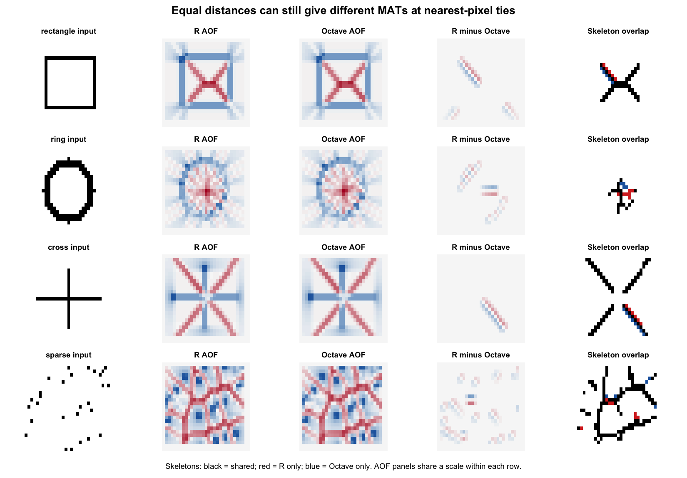

# MATLAB parity

## 0.3.0: qualification against stored MATLAB outputs

The Bernhardt-Walther lab's MLV datasets in the local reference collection
contain outputs computed in MATLAB itself: 3,017 drawings (IAPS, OASIS,
architectural scenes, Toronto scenes, Snodgrass–Vanderwart) with segment
geometry and junctions, 2,757 of them with per-pixel parallelism, separation
and mirror scores, and the complete Forest_DBW distance map, AOF and skeleton.
Re-running the pinned source (f12418a) under Octave reproduces every stored
geometry value and all junctions checked, so there is no version drift.
Natural data stay local; only harness code, synthetic fixtures and aggregate
receipts are committed. Evidence:
[junctions and geometry](evidence/mlvref/junctions/REPORT.md) and
[medial axis](evidence/mlvref/mat/REPORT.md).

The package offers two modes. Defaults correct demonstrated MLV defects
([register](../UPSTREAM_BUGS.md), MLV-M018–M031); explicit `mlv2023` options
reproduce published values.

| Stage | Published-compatible mode vs stored MATLAB | Corrected defaults vs stored MATLAB |
|---|---|---|
| Segment orientation, length, curvature | All 2,284,239 segments within 1e-9 (571 zero-length/residue segments are dropped by contract) | Same |
| Junctions | `rule = "mlv2023"`: 395,125 / 395,134 exact (position, type, contour/segment lists, angles); the 9 others need zero-length segments a drawing cannot hold | `rule = "exit"`, Euclidean gap: 356,113 (90.1%) exact; every difference attributed to a named MLV defect or definition |
| Distance map, AOF, skeleton (Forest_DBW, from the vector drawing) | `aof = "mlv2023"`, `morphology = "hmt8"`: bit-exact distances, AOF within 2.1e-14, skeleton identical (24,904 px) | Centred, tie-invariant AOF; thinning that leaves no removable (simple) pixel (`morphology = "minimal"`) |
| Per-pixel MAT scores (all 2,757 drawings) | `branch_rule = "mlv2023"`: 99.1% / 99.4% / 99.3% of pixels within 1e-4 (parallelism / separation / mirror); per-contour r 0.9993 / 0.9999 / 0.9986; residual is MLV single precision | Invariant to branch direction and numbering, loop start and lattice transforms of the MAT fields; per-contour r 0.889 / 0.972 / 0.836 against published values |

Published-compatible settings: `detect_junctions(rule = "mlv2023")`
(implies `gap_metric = "chebyshev"`) and `compute_mat(aof = "mlv2023",
morphology = "hmt8", branch_rule = "mlv2023", threshold_angle = asin(0.3 * pi / 2) * 180 / pi)`,
or the equivalent `feature_spec()` settings. The threshold angle gives flux
threshold 0.3, the value MATLAB's `computeAllMATfromVecLD` used for the lab's
datasets (it omits the threshold; MLV-M004); all qualification runs used it.
Feature specifications record every method definition, and specifications or
cached MATs built under other definitions are rejected.

Remaining boundaries: actual MATLAB was not executed, so stored outputs are the
MATLAB reference; MATLAB's undocumented `bwmorph('skel')` was identified
empirically (exact on two Forest stages); rasterization tie rules were observed
on integer endpoints only; photograph-to-drawing extraction is not qualified.

## 0.1.1: synthetic Octave/Python parity (historical)

The statements below describe 0.1.1. Its MAT conclusions are superseded by the 0.3.0 section above.

The R port agrees with the runnable reference geometry and histograms on the
retained forest demonstration, and with the correct stages of a broader synthetic
suite. Default end-to-end MAT parity is **not** established: four of six new
masks produce different skeletons because equally near boundary pixels receive
different labels. Known upstream defects are recorded rather than reproduced.

This report qualifies R source `d83ed952fdc9f639b98e849b0d8697259894de46`.
The references are MATLAB source
`f12418a5e03c2f38e222fed1dffccf42b227cd29`, executed by Octave 11.1.0
with image 2.20.0, and Python source
`14b3183b91146b1021eb7ef97db75ad703b06832`, executed by Python 3.14.7
and NumPy 2.4.3. MATLAB itself was not executed. Vendor snapshots remain unchanged.

### Executed comparison matrix

There are 18 synthetic cases, seed 9201, with 264 hashed CSV inputs/reference
outputs. See the [case list](../inst/fixtures/parity/cases.csv),
[adapter and hash manifest](../inst/fixtures/parity/manifest.json), and
[all 289 comparisons](evidence/parity-perf/parity-final.csv).

| Stage | Inputs | Result |
|---|---|---|
| Length, orientation, curvature | Three seeded integer sets and two fractional/subpixel sets | R agrees with Octave; Python agrees on integer sets within its curvature regularizer tolerance; fractional orientation/curvature expose MLV-P001 |
| Raw and normalized contour histograms | Length/orientation/curvature; 5, 8, 13 bins | Common-domain agreement; odd-bin axial boundaries expose MLV-M017/P015; Python length requires the explicitly labeled shape adapter |
| Rotation | Same five drawings, 37 degrees counterclockwise | Octave agreement with upstream angle -37; Python trigonometric rounding exposes MLV-P013 |
| Signed MAT distances | Rectangle, ring, cross, diagonal, sparse, isolated masks | All six agree within Octave distance precision; isolated ink has distance -1 after fixing MLV-R001 |
| MAT flux and morphology | Six masks, identical upstream distance/label fields or flux | All AOF comparisons within 1e-10; skeletons pixel-identical |
| Default MAT outputs | Six masks, each implementation's own nearest labels | Four skeletons differ; all disagreeing labels have identical exact squared distances |
| EDT and AOF sampling | Two spatially varying fields, AOF radii 1 and 2 | EDT agrees with both references; AOF agrees with Octave; Python exposes MLV-P012 |
| Branch scores | Constant/varying radii, curved, terminal bend, short | Parallelism/separation agree; three mirror cases agree; two expose upstream terminal line-fit defect MLV-M016 |

The receipt contains 226 matching and 63 differing comparisons: Octave
151/22, Python 75/41. These counts are diagnostic, not a percentage of
scientific validity. Every difference is classified, and the comparison runner
fails on an unclassified difference. Fifteen raw Python length-histogram
exceptions are retained separately in the manifest; the 30 adapted raw/normalized
comparisons do not count as successful unmodified Python execution.

Absolute tolerances are 1e-10 for ordinary geometry, rotation, AOF and branch
scores, 1e-9 for synthetic histogram sums, and 2e-6 for Octave distances
(single-precision output). The comparator also allows relative error 1e-12,
except exact labels/skeletons. Python curvature allows 3e-8 because its formula
adds 1e-10 to the length denominator. Label squared distances are checked exactly.
Analytical boundary, conservation, exhaustive-search and projection tests
independently decide behavior where upstream outputs are defective.

### Default MAT differences and a controlled explanation

| Mask | R skeleton pixels | Octave pixels | Differing pixels | Intersection / union |
|---|---:|---:|---:|---:|
| Rectangle | 46 | 46 | 10 | 0.804 |
| Ring | 27 | 24 | 11 | 0.645 |
| Cross | 69 | 71 | 14 | 0.818 |
| Diagonal | 32 | 32 | 0 | 1.000 |
| Sparse | 117 | 115 | 12 | 0.902 |
| Isolated | 34 | 34 | 0 | 1.000 |

R selects the lowest column-major index at an exact nearest-boundary tie;
Octave can select another equally near pixel. Distances agree to less than
7.9e-7, but boundary directions affect flux. Default AOF differences reach 26.44
on these masks; they are not dismissed as floating-point noise.

A controlled substitution keeps R's distance map and supplies Octave's nearest
labels to R's AOF kernel. All six skeletons then match exactly and the maximum
AOF error is below 1.5e-14. This isolates the label choice as the cause for these
fixtures. It does not establish that either default label policy gives a
scientifically preferable skeleton.



Black skeleton pixels are shared; red are R-only; blue are Octave-only.
Flux panels share a scale within each row. The four differing cases are shown.
[Full metrics, including the label-substitution experiment](evidence/parity-perf/mat-topologies.csv)
and the [asserted experiment log](evidence/parity-perf/visual-parity.log) are retained.

### Retained natural drawing

The optional local harness reads `demos/Forest_DBW.mat` from the verified
reference collection. SHA256:
`da1f7ed1a1e512913b0210f8aefcb83f8ef673b82fdcb7e1c5d62da2bd778fb5`.
It removes one zero-length segment/contour identically for all implementations,
leaving 562 contours and 2,072 segments. This witnesses the existing degenerate
geometry issue MLV-M015. Canonical data and reference sources are unchanged.

| Comparison | Values compared | Maximum absolute error |
|---|---:|---:|
| Geometry vs Octave | 6,216 | 5.68e-14 |
| Geometry vs Python | 6,216 | 2.17e-9 |
| Normalized histograms vs Octave | 13,488 | 1.82e-12 |
| Normalized histograms vs adapted Python | 13,488 | 2.73e-12 |

All pass explicit tolerances: 1e-8, except Python geometry at 3e-8.
Histograms cover orientation, length and curvature with eight bins per contour.
The Python shape adaptation is the same one described below. The comparator
rejects shape/nonfinite/numerical mismatches.

[Provenance and cleaning](evidence/parity-perf/natural-provenance.json),
[comparison receipt](evidence/parity-perf/natural-final-comparison.csv), and
[asserted validation log](evidence/parity-perf/natural-validation.log).
This is a drawing-level geometry/histogram witness, not natural-image MAT
acceptance or a complete photograph-to-feature comparison.

### Exact adapters and remaining boundaries

- Octave uses a temporary copy with two `jj++m_Neighbors8` expressions replaced
  by `jj + m_Neighbors8`; this is an Octave parser accommodation.
- Branch witnesses use a temporary `smoothdata(x,'movmean',k)` helper for
  explicit fixed windows only. Even windows include the current and previous
  sample at width two; endpoints shrink. These choices follow the documented
  [movmean semantics](https://www.mathworks.com/help/matlab/ref/movmean.html).
  MATLAB's omitted-window
  [smoothdata behavior](https://www.mathworks.com/help/matlab/ref/smoothdata.html)
  selects a window heuristically; the adapter does not implement that mode.
  Default taper equivalence is consequently not asserted.
- Raw Python `getLengthStats` fails under NumPy 2.4.3 when adding its
  `(n,1)` contour-length field into scalar histogram cells. Only the adapted
  comparisons reshape that field to `(n,)`; the numerical functions are unchanged.
- Pixel graph tracing, rasterization, axial mean orientation and junction
  participation have explicit R contracts. MATLAB morphology equivalence and
  the incomplete Python image pipeline remain outside the executed evidence.
- Actual MATLAB, Windows/Linux and hosted CI remain unexecuted.

New upstream findings MLV-M016/M017 and MLV-P012–P015, and R defects
MLV-R001/R002, are in [UPSTREAM_BUGS](../UPSTREAM_BUGS.md).
The ordinary installed test suite uses the committed synthetic fixtures and
does not require Octave, Python or the large reference collection.

### Reproduce

From the checkout with the optional reference runtimes installed:

```sh
export LC_ALL=en_US.UTF-8 LANG=en_US.UTF-8
export OMP_NUM_THREADS=1 OPENBLAS_NUM_THREADS=1 MKL_NUM_THREADS=1
python3 tools/bounded_check.py
# Regenerates the committed small reference fixtures from pinned source:
PYTHONDONTWRITEBYTECODE=1 python3 tools/parity/generate.py
Rscript --vanilla tools/parity/compare.R .agent-work/package-build/library .agent-work/parity-new.csv
Rscript --vanilla tools/parity/visualize.R .agent-work/package-build/library .agent-work/parity-visual
# Optional: requires the retained or restored Forest_DBW.mat collection:
PYTHONDONTWRITEBYTECODE=1 python3 tools/parity/natural.py
Rscript --vanilla tools/parity/compare_natural.R .agent-work/package-build/library new
```

Use [verify_references.py](../tools/verify_references.py) to check reference custody
and [restore_upstream.py](../tools/restore_upstream.py) if reference data are absent.
The package build uses a monitored 200 MiB owned workspace. See the
[qualification receipt](QUALIFICATION_0.1.1.md) and
[performance measurements](PERFORMANCE_0.1.1.md).
