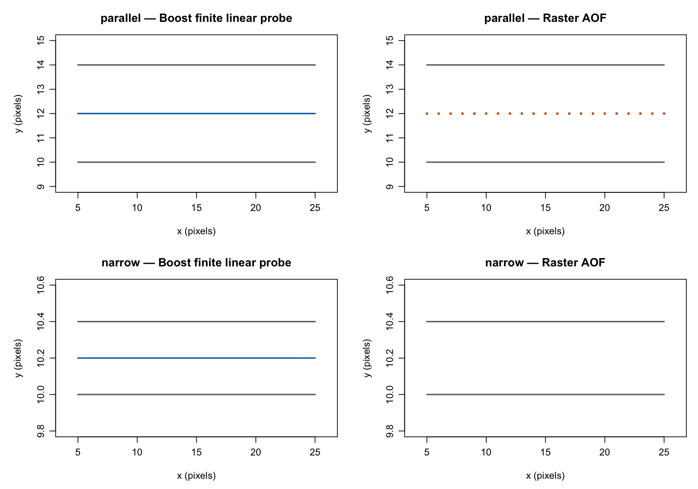

# Segment-Voronoi feasibility decision

Decision: proceed to a separately scoped backend implementation study. This
probe is not ready to replace AOF or become a package default. It demonstrated
stable segment correspondence and a subpixel narrow-gap advantage on the fixed
fixtures, while explicitly leaving curved/unbounded edges and complete medial
selection unresolved. No permanent dependency or public package backend was added.

## License and build preflight

Installed BH 1.90.0.1 provides `boost/polygon/voronoi.hpp`; the exact header hash,
compiler and include path are recorded in [preflight](evidence/voronoi-spike/preflight.json).
Boost.Polygon's Voronoi implementation uses the Boost Software License 1.0.
Its default inputs use integral coordinates and disallow intersections except
at shared endpoints. [Boost Voronoi documentation](https://www.boost.org/doc/libs/latest/libs/polygon/doc/voronoi_main.htm),
[Boost license](https://www.boost.org/LICENSE_1_0.txt).

The CGAL 6.2.1 Segment Delaunay component is GPL, with the manual referring to
GPL v3. The package already declares GPL (>=3); this suggests no license-model
obstacle from that component alone, provided distribution obligations are met.
CGAL was not installed or compiled by this experiment, so its transitive build
burden and platform support remain unmeasured. Boost was tried first as planned.
[CGAL component](https://doc.cgal.org/latest/Segment_Delaunay_graph_2/group__PkgSegmentDelaunayGraph2Ref.html),
[CGAL license manual](https://doc.cgal.org/latest/Manual/license.html).

The standalone C++17 Boost translation unit compiled cleanly with local Apple
clang in 1.5–1.8 seconds, using 180–188 MiB sampled peak process-tree
RSS across the two runs. This is a local clean compilation measurement, not a CRAN build-time or
cross-platform qualification. It uses installed headers without changing
DESCRIPTION, LinkingTo, or the package's raster backend.

## Quantization and geometry contract

The frozen fixtures use a scale of 1,000 integral units per input pixel: maximum
coordinate rounding error 0.0005 pixel, Euclidean endpoint bound approximately
0.000707 pixel. Coordinates exceeding signed-int32 capacity are rejected.
Exact intersections are split first, retaining original source-segment IDs.
Collinear overlaps, collapsed spans, introduced intersections and changed
source-incidence topology are rejected before Boost. These checks establish the
tested cases; they are not a proof of topology preservation for arbitrary inputs.

The finite domain is the canvas rectangle `[1,width] × [1,height]`. The probe
retains finite, linear, primary Voronoi edges between distinct original source
segments and clips them to that rectangle. It counts but does not implement
curved edges or unbounded rays. This selected subset of a zero-width segment
Voronoi diagram is not the existing raster AOF MAT. Stroke geometry, open-drawing
domain semantics and complete boundary-to-branch mapping still need a production
contract.

## Fixed results

Twelve cases were fixed before execution: parallel lines; three translations;
a 0.4-pixel gap; rectangle; crossing; a curved-edge configuration; and four
invalid/quantization cases. [Raw results](evidence/voronoi-spike/results.csv),
[frozen contract](evidence/voronoi-spike/fixture-manifest.json),
[source-pair identities](evidence/voronoi-spike/source-pairs.json).

* All five parallel/gap cases retain the analytical 20-pixel finite centerline.
  Translation perturbations preserve source-pair identity; maximum axis error is
  0.0004 pixel, within the quantization bound.
* Selected edges satisfy independent nearest-segment and equal-distance checks;
  the largest observed residual is about 1.8e-15 pixel.
* The 0.4-pixel gap remains distinct in the vector probe. Both rasterized input
  lines become the same pixel mask, and this AOF input produces no skeleton.
  The ordinary four-pixel gap produces the expected raster centerline.
* Crossing input is split into four legal segments while retaining its two
  original segment owners. Overlap, overflow, a collapsing gap and a quantized
  near-miss topology change are refused, with the actual reasons retained.
* The curved fixture contains six unsupported curved primary edges and three
  unbounded primary edges. Even the simple parallel case has two unbounded
  primary edges outside the finite selected centerline. These prevent claiming
  a complete replacement backend.

Gray lines show original vector input, blue the selected finite Boost centerline,
orange the raster AOF skeleton. The narrow raster panel's two gray vector lines
collapse to one mask before AOF. The y ranges are zoomed independently; they do
not represent equal physical aspect ratios. The figure was visually inspected.

Native construction was measured over 1,000 repetitions per valid case; complete
raster computation over 25. Full logs include native process RSS, construction
time, process-launch overhead and raster timings. These are different workloads,
so their raw timings are not a claim of end-to-end speedup. Source, fixture,
binary and installed-package identities are in
[provenance](evidence/voronoi-spike/provenance.json). The R comparisons used the
retained graph candidate archive, separately identified from the later native
large-index safety refinement.

The implementation and experiments finished well inside the four-hour cap;
[timebox receipts](evidence/voronoi-spike/timebox-result.json) record start,
experiment completion and reporting duration. The driver enforces per-phase
time limits, a 2 GiB process-tree RSS cap and a 200 MiB owned-workspace cap.
Initial and final runs are both retained; the final run adds the direct raster
mask-collapse assertion. No MATLAB, Linux/Windows or CRAN execution was performed.

A follow-up would need curved-edge evaluation, robust unbounded clipping,
complete medial selection/domain rules, stronger quantization topology evidence,
and source-correspondence mapping into the public branch API before any backend
or default proposal. The positive narrow-gap result justifies that separate work;
it does not establish general scientific or perceptual superiority.
